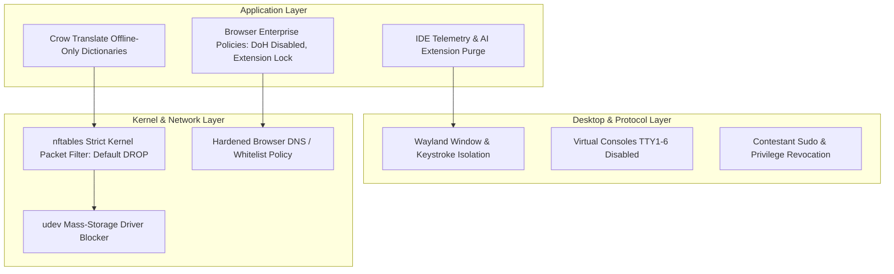

# GallosOS Network Lockdown & Security Hardening Specification

This document details the multi-layered security architecture, network whitelist enforcement, peripheral locking, and integrity controls specified for **GallosOS**.

This specification includes implemented mechanisms and planned controls. [`ROADMAP.md`](../ROADMAP.md) tracks their implementation separately from live-image, graphical, and physical acceptance. A checked implementation item, policy declaration, or passing unit test does not establish effective enforcement on a contestant workstation.

---

## 1. Threat Model & Integrity Goals

In modern competitive programming (ICPC, IOI, local tournaments), unauthorized access to Generative AI coding assistants, remote problem solvers, or hidden code storage completely undermines contest integrity.

### 1.1 The AI Risk Philosophy

Generative AI presents a risk to contest integrity. GallosOS currently limits network access in Contest and in named-host training profiles. The club and neutral Default profiles allow general browsing; blocking AI sites and AI-generated search panels remains a separate release requirement. A domain list cannot remove AI answers embedded on an otherwise allowed search page, and an allowed judge may itself host AI features. Do not claim those controls are active until they have been implemented and tested.

For the later search-policy design, [DuckDuckGo NoAI](https://duckduckgo.com/duckduckgo-help-pages/ai-features/about-noaiduckduckgocom) is an explicit no-AI search option. [Startpage Anonymous View](https://support.startpage.com/hc/en-us/articles/4455317663764-How-does-Anonymous-View-work) is a proxy for opening arbitrary search results, so admitting its proxy hosts would bypass a judge-domain allowlist. Google's [Web filter](https://support.google.com/websearch/answer/14901683) shows text links; permitting ordinary Google results as “AI-free” requires a separate enforced-navigation design and graphical verification. None of these candidates is an active GallosOS restriction yet.

### Deferred web relay review

An allowed website that fetches another URL on the user's behalf can hide the final destination from a hostname-only allowlist. The future anti-AI and search policy must review these services as web relays, alongside AI endpoints. This is a review list, not a complete blocklist or an active ISO policy.

| Candidate | Documented behavior | Review before allowing the service |
| --- | --- | --- |
| [Google Translate website translation](https://developers.google.com/search/docs/appearance/ad-network-and-translation) | Google retrieves the source page and serves translated content on a hostname ending in `.translate.goog`. | Distinguish text translation from website translation; inventory entry points and translated-page hosts, then test whether an arbitrary destination can be opened. |
| [CroxyProxy](https://www.croxy.network/) | Its website offers browsing of other sites through its web proxy. | Identify the current official service hosts, alternate hosts, redirects, and browser extension behavior before deciding how to exclude it. |
| [Startpage Anonymous View](https://support.startpage.com/hc/en-us/articles/4455317663764-How-does-Anonymous-View-work) | It opens search results through Startpage's proxy. | Determine whether search can remain available while Anonymous View and its relay hosts are inaccessible. |

Hostname inventory alone is insufficient to prove a restriction: verify real browser navigation and attempts to open a blocked destination through each allowed service. Do not infer that every host under a search or translation provider is safe merely because one feature is permitted.

### 1.2 Primary Threat Vectors

1. **Cloud AI & LLM Endpoints:** OpenAI API, Anthropic Claude, Google Gemini, GitHub Copilot, Cursor backend, Perplexity, HuggingFace Inference.
2. **IDE AI Plugins & Telemetry:** Pre-installed Copilot / Supermaven / JetBrains AI Assistant communicating via hidden sockets.
3. **Evasion Tunnels:** DNS-over-HTTPS (DoH), DNS-over-TLS (DoT), WireGuard, OpenVPN, SSH port-forwarding, Tor bridges, SOCKS5 proxies.
4. **Unauthorized Mass Storage:** USB flash drives containing pre-written templates or algorithm libraries plugged in during contest hours.
5. **Hardware Macros (BadUSB):** Personal keyboards with internal memory injecting pre-baked scripts at superhuman speeds.
6. **Session Leakage:** Snooping on other workstation windows via legacy X11 protocol vulnerabilities.
7. **Low-Level Sandbox Evasion & Syscall Manipulation:** Execution of direct kernel system calls (`syscall` / inline assembly `__asm__` blocks) or compiler/kernel exploits to escape local sandboxes, access forbidden directories, or tamper with background monitoring agents.

> [!NOTE]
> **Current scope:** Restricted Organizer policies can request network, proxy, and device controls. The neutral profile is open practice. Broad anti-AI website/search restrictions and removal of AI plugins from expanded IDE packages are not implemented; no complete anti-cheat or zero-leak guarantee is made. See [`ROADMAP.md`](../ROADMAP.md) and verify enforcement on a booted image.

---

## 2. Multi-Layered Zero-Trust Architecture

The diagram is a target model. AI plugin purging, browser extension allowlisting, translation tooling, Wayland proctoring, and several device controls shown here are not all implemented. See the adjacent status notes and [`ROADMAP.md`](../ROADMAP.md).



---

## 3. Network Isolation & Firewall Architecture

Restricted Organizer policies use a default-drop egress policy. The neutral profile allows open practice. The following rule excerpts illustrate the intended restricted-mode rules and do not describe every active policy.

### 3.1 Kernel Packet Filter (`nftables`)

> [!IMPORTANT]
> **These sets are illustrative placeholders.** `gallosd` resolves configured Contest websites to IPv4 addresses for restricted proxy egress; a broad network range would weaken the intended judge-only boundary. Applying the rules and proxy still requires live-image enforcement tests. A failed required Contest transition keeps the kiosk stopped and is reported by `gallosctl status`.

> [!NOTE]
> **IPv6 handling:** The build disables IPv6 at boot, and restricted policies render an `inet` family default-drop firewall. Default/Event modes remain open when no website list is configured. Live enforcement still requires release-image testing.

```nftables
#!/usr/sbin/nft -f

table inet gallos_filter {
    # Judge server(s) reachable during Contest mode, derived from
    # [contest].allowed_websites in gallos.toml:
    #   - Self-hosted LAN judges (BOCA / DOMjudge / CMS, the typical ICPC
    #     onsite case): the organizer's specific static judge-server IP(s),
    #     resolved once and pinned into /etc/hosts at configure-time rather
    #     than re-resolved live. [Precedent: maratona-firewall's
    #     config-ip-boca.sh does exactly this — see §3.4.]
    #   - CDN-fronted remote judges (Codeforces, AtCoder, omegaUp): kept in
    #     sync via periodic DNS resolution — see §3.4.
    set allowed_judge_ips {
        type ipv4_addr
        flags interval
        elements = { 192.168.50.10 }   # example: single self-hosted BOCA host
    }

    # Venue Controller only (CUPS printing + audit/telemetry upload).
    # Scoped to one host and explicit ports — never the whole LAN.
    # IDEA FOR LATER (not adopted): the real ICPC World Finals ruleset
    # (icpcsysops/ansible do_iptables.yml) scopes every Controller service to
    # its own separate /32+port rule instead of one shared set. Consider
    # splitting this set into per-service rules to match more closely.
    set allowed_venue_controller_ip {
        type ipv4_addr
        elements = { 192.168.50.1 }    # example: Venue Controller LAN IP
    }

    set telemetry_dns_blacklist {
        type ipv4_addr
        elements = {
            1.1.1.1, 1.0.0.1,         # Cloudflare DNS bypasses
            8.8.8.8, 8.8.4.4,         # Google DNS bypasses
            9.9.9.9, 9.9.9.10,        # Quad9 / JetBrains IDE telemetry DNS
            149.112.112.10, 149.112.112.112
        }
    }

    chain output {
        type filter hook output priority 0; policy drop;

        # 1. Allow Loopback (Required for IDE local debuggers and local doc servers)
        oif "lo" accept

        # 2. Allow Established / Related connections
        ct state established,related accept

        # 3. Hard-Drop Broadcast, Multicast & Telemetry Clutter (prevents discovery leakage)
        #    mDNS (5353) is dropped unconditionally, full stop. [Precedent: the
        #    real ICPC World Finals ruleset REJECTs 5353 outright — onsite
        #    printers are statically configured, no Avahi/mDNS broadcast on
        #    contestant machines at all.] GallosOS follows the same default:
        #    [contest.printing] mode = "hosted" targets a static CUPS server
        #    IP (printer_host) by default; mDNS discovery is opt-in only via
        #    enable_mdns_discovery = true, which — if set — narrowly reopens
        #    5353 scoped to allowed_venue_controller_ip alone (not shown here,
        #    since it's off by default).
        udp dport { 137, 1124, 3289, 3702, 5353, 8610, 8612 } drop
        ip daddr { 224.0.0.1, 224.0.0.22, 239.255.255.250, 255.255.255.255 } drop

        # 4. Hard-Drop Hardcoded IDE DNS Resolvers & DoT/DoH
        ip daddr @telemetry_dns_blacklist drop
        tcp dport 853 drop

        # 5. Allow Local DNS (Port 53 UDP/TCP) to verified local gateway only (dynamically populated by gallosd)
        udp dport 53 ip daddr 192.168.1.1 accept
        tcp dport 53 ip daddr 192.168.1.1 accept

        # 6. Allow NTP Time Synchronization (Port 123) — scoped to the
        #    Venue Controller (if it hosts NTP) or the organizer-configured
        #    campus NTP pool IP(s), never wide open. An unrestricted NTP rule
        #    is an unmonitored outbound channel regardless of judge whitelisting.
        udp dport 123 ip daddr @allowed_venue_controller_ip accept

        # 7. Allow only the restricted proxy to reach Whitelisted Judge IPs.
        #    Contest browsers and HTTP(S) clients are locked to localhost:3128;
        #    direct workstation egress is not permitted.
        meta skuid proxy tcp dport { 80, 443 } ip daddr @allowed_judge_ips accept

        # 7a. Venue Controller printing: CUPS/IPP (631), static IP only —
        #     no mDNS (5353) unless enable_mdns_discovery = true (see rule 3)
        tcp dport 631 ip daddr @allowed_venue_controller_ip accept

        # 7b. Venue Controller audit/telemetry upload (fleet metrics,
        #     screenshot sync, code backup) — HTTPS to the Controller only
        tcp dport 443 ip daddr @allowed_venue_controller_ip accept

        # 7c. ICMP: asymmetric, not blanket-dropped. [Precedent: the real
        #     World Finals ruleset accepts ping only from its backup/admin
        #     subnet and drops+logs everything else.] Diagnostic ping is
        #     useful for on-site troubleshooting without opening a general
        #     ICMP hole.
        icmp type echo-request ip saddr @allowed_venue_controller_ip accept

        # 8. Rate-limited Audit Logging for Denied Outbound Attempts
        limit rate 5/minute burst 7 packets log prefix "GALLOS_DENIED: " flags all

        # 9. Reject everything else with immediate ICMP port unreachable
        reject
    }

    chain input {
        type filter hook input priority 0; policy drop;
        iif "lo" accept
        ct state established,related accept
    }
}
```

### 3.2 DNS-over-HTTPS (DoH), Telemetry & Tunnel Mitigation

- **Resolver and telemetry controls:** The generated Contest rules block configured telemetry DNS addresses and TCP ports 22/853. Browser policy generation writes URL allow/block rules, proxy settings, and telemetry settings for Firefox and Chromium. Chromium is not part of the selected installed browser core; verify the policy in each installed application before claiming enforcement. DNS filtering alone does not prove that AI services are blocked.

### 3.3 Browser Sub-URL Filtering (omegaUp / Platform Lockdown)

At the kernel level, `nftables` can only filter by IP addresses and domain names (e.g., `omegaup.com`). Because HTTPS encrypts the URL path, the firewall cannot distinguish between an allowed contest link (`/arena/contest/omi2026`) and a banned public problem archive (`/arena/problem/`).

The daemon writes managed Chromium and Firefox policy files to apply configured URL allow/block rules. These policies constrain navigation in supported browsers; they are not a whole-workstation content filter.

When the active mode includes a host allowlist, the generated browser policies apply that allowlist and any configured `browser_policy.url_blocklist` patterns:

- **`URLBlocklist`**: Blocks `https://omegaup.com/arena/problem*`, `/submissions*`, `/course*`, `/rank*`.
- **`URLAllowlist`**: Unblocks only `/login`, `/api/*`, and the specific `/arena/contest/*` route.

The result depends on browser support and effective policy loading. Test the actual browser, direct navigation, redirects, and alternate hosts on the release image.

### 3.4 Contest Proxy Egress and DNS Refresh

When entering Contest, `gallosd` resolves configured `allowed_websites` to IPv4 addresses and constrains the proxy process's TCP egress to those addresses. A background resolver refreshes the set approximately every 45 seconds while the daemon is running. This is IP-level egress control combined with proxy hostname ACLs; it does not inspect encrypted URL paths or distinguish unrelated tenants sharing a CDN edge address.

> [!NOTE]
> **Limits:** Restricted Contest traffic uses the local proxy, while the firewall limits proxy egress to the resolved addresses. The proxy checks HTTP destinations and CONNECT authorities; it does not decrypt TLS or inspect encrypted URL paths. Shared CDN addresses and judge-hosted features remain limitations. This is not a content filter and does not make third-party judges free of AI features or proxy-like functionality.
>
> **IDEA FOR LATER, not adopted:** `icpc-environment/icpc-env` closes this exact gap for real — it forces all contestant traffic through a local Squid instance with full TLS interception (`ssl_bump bump all`, a self-signed CA installed system-wide, UID-locked to the contestant user) backed by an nginx reverse proxy doing per-path filtering on the decrypted traffic (`files/squid/squid.conf.j2`, `files/nginx.conf.j2`). This would give real hostname/path-level filtering instead of IP allowlisting, at the cost of trusting a MITM proxy in the TCB and installing a CA cert everywhere. Flagged as a documented option for a future design decision, not implemented here.
>
> **Related reference implementations:** The linked `icpc-env` source contains Squid TLS-interception and nginx reverse-proxy templates. The inspected `icpcsysops/ansible` source contains a `roles/reverseproxy` role and an example `squidserver` host, but the referenced Squid configuration was not present in the reviewed tree. These files document design patterns; they do not establish current deployment or GallosOS implementation. TLS interception remains an unevaluated design choice for GallosOS because it adds a trusted proxy and certificate to the security boundary. See [`docs/COMPARATIVE_ANALYSIS.md`](./COMPARATIVE_ANALYSIS.md) §9.1.

---

## 4. IDE Hardening & Licensing Strategy

### 4.1 VSCodium (Default Open Source IDE) & C/C++ Extension Strategy

The build installs VSCodium and writes contestant defaults disabling telemetry and application/extension updates. Those settings still need verification in the installed application. The extension and alternate-editor workflows below are plans, not delivered features.

1. **VSCodium Distribution:** The selected image uses VSCodium, a community build of Code-OSS. Verify marketplace access and license terms for any extension before bundling it.
2. **Open-Source C/C++ Extension Candidates (`clangd` + `webfreak.debug`):**
   - **Why NOT `ms-vscode.cpptools`:** Microsoft's official `ms-vscode.cpptools` extension contains proprietary license restrictions restricting its use strictly to official Microsoft builds. Starting in April 2025, Microsoft introduced runtime checks that detect non-official builds and actively block execution in VSCodium/Code-OSS. Attempting to bypass these checks violates Microsoft's EULA.
   - **Candidate:** Evaluate **`llvm-vs-code-extensions.vscode-clangd`** and **`webfreak.debug`** for offline installation, compatibility, licensing, and contestant workflow before adding them to the image.
3. **Alternative Official Microsoft VS Code Track:**
   - An official Microsoft VS Code build is not currently part of the build pipeline. Any future distribution path requires licensing and update-policy review.
   - The current contestant settings file includes:

     ```json
     {
       "extensions.autoUpdate": false,
       "extensions.autoCheckUpdates": false,
       "extensions.showRecommendationsOnlyOnDemand": false,
       "extensions.ignoreRecommendations": true,
       "telemetry.telemetryLevel": "off"
     }
     ```

4. **Planned Extension Selection (not implemented):**
   - **`vscode-clangd`** (LLVM Language Server for fast offline C++ autocompletion).
   - **`webfreak.debug`** (Native GDB debugger).
   - **Competitive Programmer Helper (CPH)** (Offline/Online testcase runner for training).
   - **Vim Emulation (`vscodevim.vim` / `IdeaVim`)** (Modal keybindings for VSCodium and JetBrains).

   The following is a proposed configuration shape; the current schema/daemon do not install, remove, or select extensions per mode:

   ```toml
   [default.ide_extensions]
   vscodium = ["llvm-vs-code-extensions.vscode-clangd", "webfreak.debug", "cph", "vscodevim.vim"]
   jetbrains = ["IdeaVim"]

   [contest.ide_extensions]
   # In strict contest mode, CPH is omitted, leaving pure language servers & modal keybindings
   vscodium = ["llvm-vs-code-extensions.vscode-clangd", "webfreak.debug", "vscodevim.vim"]
   jetbrains = ["IdeaVim"]
   ```

   > [!TIP]
   > **Mode-Sensitive Extension Control:** Extensions like **CPH** and browser companions (**Competitive Companion**) streamline practice during `Default` and `Event` training (Codeforces, AtCoder, CSES). In strict onsite tournaments (ICPC / IOI with DOMjudge/BOCA), organizers can omit them from `[contest.ide_extensions]` to enforce strict manual testing rules.

### 4.2 JetBrains Ecosystem (Optional Phase 6 Evaluation)

- JetBrains IDEs are not included in the selected release core. Evaluate their licensing, package availability, offline operation, and telemetry behavior before adding them.
- Per-mode plugin selection and AI-plugin removal are not implemented; see Phase 6 in [`ROADMAP.md`](../ROADMAP.md).
- Sponsored license injection, offline IDE packaging, and removal of `com.intellij.ml.llm` are future evaluation items. No JetBrains AI-plugin purge is active in the current build.

### 4.3 Proprietary Kernel Modules (GPU Drivers) & SecureBoot Taint Policy

This is planned Phase 4 work. The current ISO does not package the NVIDIA module or a MOK enrollment workflow, and `gallos.toml` cannot enable it.

If implemented, the `drivers/nvidia-proprietary` bundle would contain a closed-source, out-of-tree DKMS kernel module. Loading such a module taints the kernel; signing would support Secure Boot validation but would not remove that taint. The proposed build and enrollment flow needs review and per-machine testing before use. See [`HARDWARE_COMPATIBILITY.md` §1.3](./HARDWARE_COMPATIBILITY.md#13-planned-proprietary-gpu-drivers--mok-signing) and [`BUILD_SYSTEM.md` §4](./BUILD_SYSTEM.md#4-mok-signing-key-persistence-optional-proprietary-kernel-modules).

---

## 5. Peripheral & USB Storage Lockdown

During **`Contest` Mode**:

Default and Event honor their own `allow_usb_storage` flag (default `true`), including policy reloads and Contest exit. Contest always denies external storage. Post-Contest notifications report the target policy instead of promising that storage is always unlocked.

- **HID Allowed:** USB keyboards, mice, and assistive devices are permitted.
- **Mass Storage Blocked (primary mechanism — polkit/udisks2 denial):** When `allow_usb_storage = false`, `gallosd` (and the build-time hardening stage) installs a `polkit` rule denying the `contestant` user all `org.freedesktop.udisks2.*` actions outright (`ResultAny=no` / `polkit.Result.NO`), so mass-storage devices are refused at the policy layer before they're ever mounted. [Precedent: this directly follows `maratona-usuario-icpc`'s real polkit rules, which deny the `icpc` user `NetworkManager.*`, `timedate1.*`, and `udisks2.*` actions the same way.]

  > [!NOTE]
  > **Polkit `.pkla` vs. Modern JavaScript `.rules` (Ubuntu 24.04 LTS):**
  > While upstream `maratona-usuario-icpc` used the legacy `.pkla` (localauthority) backend format shown below for illustration, Ubuntu 24.04 LTS (`noble`) ships `polkitd >= 106`, which dropped `.pkla` support entirely in favor of JavaScript rules in `/etc/polkit-1/rules.d/`. GallosOS translates this rule to `/etc/polkit-1/rules.d/99-gallos-usb-block.rules` (`polkit.addRule(...)`). See [`vendor/inherited/maratona-usuario-icpc/UPSTREAM.md`](../vendor/inherited/maratona-usuario-icpc/UPSTREAM.md).

  ```javascript
  // /etc/polkit-1/rules.d/99-gallos-usb-block.rules
  polkit.addRule(function(action, subject) {
      if (action.id.indexOf("org.freedesktop.udisks2.") === 0 && subject.user === "contestant") {
          return polkit.Result.NO;
      }
  });
  ```

  *(Legacy `.pkla` equivalent from `maratona-usuario-icpc`):*

  ```ini
  # /etc/polkit-1/localauthority/50-local.d/99-gallos-usb-block.pkla
  [Block mass storage for contestant]
  Identity=unix-user:contestant
  Action=org.freedesktop.udisks2.*
  ResultAny=no
  ResultInactive=no
  ResultActive=no
  ```

- **Existing mounts:** `gallosd` synchronously starts `gallos-usb-storage@lock.service`. The helper runs in the host mount namespace with `CAP_SYS_ADMIN`, rather than attempting unmounts inside the daemon's sandbox. It joins structured `lsblk` ancestry with the complete `findmnt` mount list, so partitions without their own transport field, bind mounts, and paths containing spaces are included. It unmounts nested paths first and verifies that no targeted mount remains. Busy mounts or enforcement errors keep the kiosk stopped.

- **Live medium and HID:** The helper preserves system mounts (including `/cdrom` and `/isodevice`) and their underlying USB storage interfaces. It unmounts other partitions on that medium but leaves the boot interface authorized. Other class-08 storage interfaces are deauthorized through their resolved sysfs interface path; keyboard and mouse interfaces remain active. These behaviors have regression coverage; physical USB and booted-live acceptance remain required.

- **New storage interfaces:** A runtime `udev` rule denies class-08 interfaces. It is installed after boot-medium discovery is possible, rather than baked into the image where coldplug could disable the live USB:

  ```bash
  # /etc/udev/rules.d/99-contest-usb-block.rules (managed by the host helper)
  ACTION=="add", SUBSYSTEM=="usb", ENV{DEVTYPE}=="usb_interface", ATTR{bInterfaceClass}=="08", ATTR{authorized}="0"
  ```

- At Contest exit, `gallos-usb-storage@unlock.service` removes the denial rules, reloads udev, authorizes connected class-08 interfaces and explicitly probes their drivers so contestants can mount storage for code export. Interface authorization and the required driver probe follow the [Linux kernel USB authorization interface](https://docs.kernel.org/usb/authorization.html#interface-authorization).

---

## 6. Keyboard Layout Selector

Contestants come from diverse international backgrounds and require specific layout mappings:

- **Supported Layouts:** `latam` (Latin America), `us` (US English), `es` (Spain), `br` (Brazil ABNT2), `dvorak`.
- **Fast Switching:**
  - **Global Hotkey:** `Super + Space` (or `Alt + Shift`) cycles through active layouts.
  - **Status Bar Module:** Visual flag/text indicator in Waybar status bar.
  - **Persistence:** Layout choice is saved across app launches within the session.

---

## 7. Offline Documentation & Translation

Offline documentation and dictionary packages are planned Phase 4 work. The current image does not bundle the catalog described below.

The proposed catalog would help contestants work offline without relying on Google Translate or DeepL:

1. **Candidate Offline Language Documentation (`/usr/share/doc/`):**
   - C++: `cppreference-doc`; Java: the JDK API; Python: Python documentation; Kotlin/Rust: language manuals.

2. **Proposed Translation Options (Offline Dictionary or Approved Online Service):**
   - **Offline dictionary candidate:** A local `dictd` service with FreeDict bilingual databases (`eng-spa`, `eng-por`) and StarDict lexicons could support air-gapped lookups. This is not currently bundled or verified.
   - **Controlled Online Translation Mode (Future Design):** If an Organizer permits translation, evaluate a text-only API separately from browser-based website translation. Do not assume that allowing `translate.google.com` or translated-page hosts under `.translate.goog` preserves a judge-domain restriction; Google documents that its website translation fetches and rewrites source pages. Validate any proposed API endpoint and client behavior before adding it to `gallos.toml`.
   - **Local fallback:** If both modes are implemented, a local dictionary could remain available when online services are unreachable. No automatic fallback currently exists.

---

## 8. Administrative Proctoring, Auditing & Fleet Telemetry

The services and data collection described in this section are planned Phase 7 capabilities. No screenshot, keystroke, code-backup, active-window, or fleet-export pipeline is implemented by the current GallosOS runtime.

For future evaluation, the architecture proposes an **opt-in, declarative auditing engine**. The current runtime does not provide or manage this engine:

### 8.1 Periodic Desktop Screen Auditing

- **Proposed capture:** A future privileged service could evaluate periodic desktop capture using compositor protocols (`grim` / `wlr-screencopy`).
- **Proposed interval & storage:** A future policy could configure an interval (for example, 60 seconds) and a local or remote storage destination. Identity mapping, capture, and upload are not implemented.
- **IDEA FOR LATER, not adopted:** IOI 2025 Contestant-VM's real `contest.sh monitor` (cron, every minute) captures a screenshot with only 50% probability per invocation rather than a deterministic fixed interval — a cheaper-storage sampling alternative worth considering. Not implemented here.

### 8.2 Automated Incremental Code Backups

- **Proposed backup:** A future service could snapshot `/home/contestant/` on a configured interval, informed by IOI's `ioibackup.sh` and ICPC World Finals SysOps' backup watchdog subsystem.
- **Potential uses:** An accepted backup workflow might support later review or workstation recovery. The current runtime does not provide the described timeline, remote restore, or recovery script.
- **IDEA FOR LATER, not adopted:** the real `ioibackup.sh` also enforces a 100KB per-file size cap and a 1MB/s bandwidth throttle on the rsync. GallosOS's `backup_interval_secs` has neither knob today — at 50–200 machines, a simultaneous unthrottled backup burst to the Venue Controller could saturate the venue LAN. Worth adding `backup_max_file_size` / `backup_bandwidth_limit_kbps` to `[contest.audit]` in a future revision; not implemented here.

### 8.3 Privileged Keystroke Forensics (Optional for IOI / Olympiads)

- **Proposed input audit:** A future service could evaluate input-event capture, informed by `martkeys` in ICPC World Finals SysOps. The schema field is not consumed by the daemon, and no keystroke stream is collected.
- **Policy and privacy requirements:** Any future design needs explicit organizer policy, legal/privacy review, access controls, retention limits, and image-level acceptance before use.
- **IDEA FOR LATER, not adopted:** the real `martkeys` shipped config (`roles/martkeys/files/keys.yaml`) does **not** log raw keystroke content by default — only aggregated `modifier`/`metrics` (click rate, cadence sampled every 60s) feed its output; a raw per-key capture mode exists but is commented out, implying it's reserved for targeted forensic investigation rather than always-on. A metrics-only default (with raw capture as an explicit, separately-invoked escalation) may be a more privacy-defensible default than "raw JSONL stream" as currently described here. Not implemented — flagged for a future decision.

### 8.4 Process Hierarchy & Focused Window Tracking

- **Proposed activity journal:** A future service could evaluate process-tree sampling and focused-window tracking, informed by `s.py` from ICPC SysOps. The current daemon does not perform this sampling.
- **Potential use:** If implemented and accepted, this might help operators inspect which applications ran during an event. It would not by itself detect cheating.
- **IDEA FOR LATER, not adopted:** the real `s.py` (`roles/team/files/s.py`) detects the focused window via X11-only `xprop`/`_NET_ACTIVE_WINDOW`, which has no Wayland/labwc equivalent and cannot be ported as-is. The process-hierarchy half above is already portable. A Wayland-native replacement for the window-focus half (e.g. `wlr-foreign-toplevel-management`) is needed before this feature can be implemented; not designed here.

### 8.5 Fleet Telemetry & Monitoring

- **Proposed exporters:** A future Venue Controller design could evaluate `node-exporter` and a GallosOS-specific exporter.
- **Proposed dashboard:** Centralized metrics would require a separate service, network policy, data model, and retention plan; none is included in the current build.

---

## 9. Privilege and Process Isolation Boundaries

GallosOS does not provide a syscall sandbox for contestant programs. A contestant process runs under the unprivileged `contestant` account, but it can still invoke ordinary Linux system calls permitted to that account. These measures reduce administrative access; they do not prevent kernel exploits, arbitrary resource consumption, or all cross-process attacks.

### 9.1 Privileged Command & Sudo Revocation

- **Remove `sudo`:** The build removes `sudo`; Organizer root recovery is a separate, explicitly configured local feature. This is not a filesystem sandbox.
- **Polkit and device policy:** Selected system actions are restricted through Organizer policy. These rules do not block arbitrary syscalls or turn the contestant account into a container.

### 9.2 Immutable Read-Only Root Filesystem (SquashFS + OverlayFS)

- **SquashFS Layer Integrity:** Critical OS directories (`/bin`, `/sbin`, `/lib`, `/usr`) reside inside the read-only SquashFS container.
- **Volatile root layer:** Changes to the writable OverlayFS upper layer are lost at reboot. Optional `event-data` and external media can persist; a live-image test is required to verify Contest cleanup and accessibility.

### 9.3 Daemon Service Sandboxing

`gallosd.service` has service-level systemd restrictions, including `ProtectSystem` and an OOM score adjustment. These apply to that service; they do not impose `seccomp` filters or filesystem restrictions on contestant applications.

### 9.4 Wayland Client Boundaries

- Wayland mediates clients' access to input and other windows through the compositor. This narrows some cross-client access compared with X11, but does not make key capture, screen capture, or application compromise impossible; applications still run as processes in the same user session.
