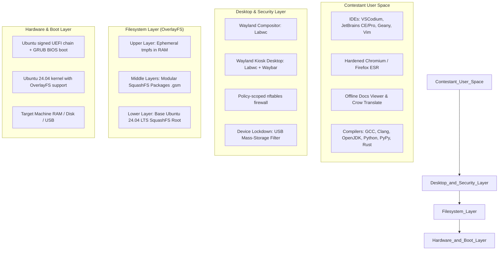
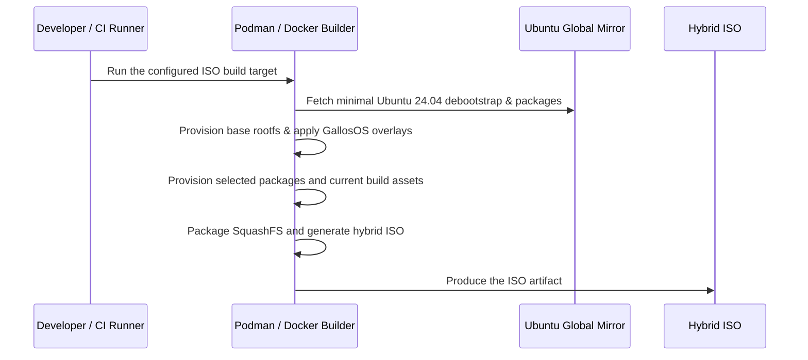
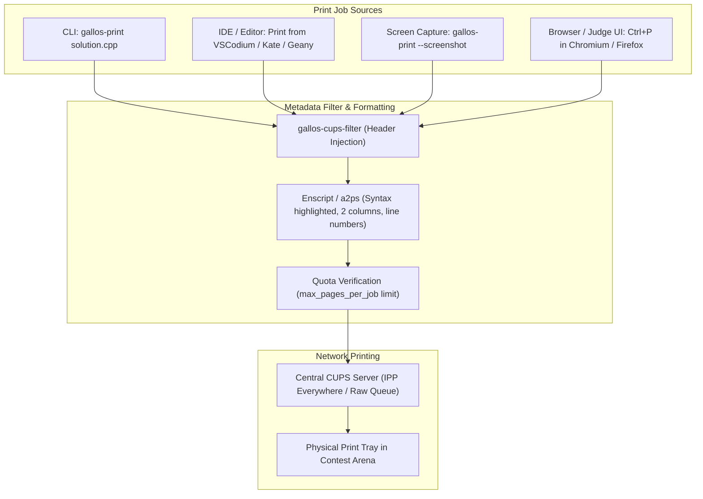
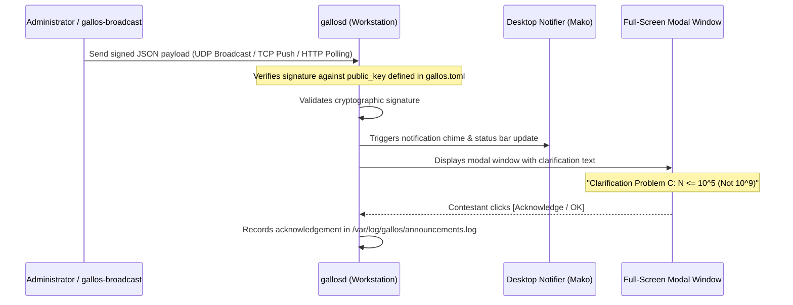

# GallosOS Architecture & System Design

This document provides a comprehensive technical overview of the architecture, subsystems, build pipeline, and execution environments of **GallosOS**.

The design includes implemented and planned capabilities. Consult [`ROADMAP.md`](../ROADMAP.md) for implementation status, selected core versus optional software, and separate release-acceptance results. Architecture diagrams describe intended relationships, not evidence that every component is installed or verified.

---

## 1. System Overview & Layered Architecture

GallosOS uses a layered Live-boot design with a read-only SquashFS base and a RAM-backed writable layer. This supports rollback of volatile root changes; it does not guarantee bit-for-bit reproducible builds, tamper-proof runtime enforcement, or venue readiness.

The diagram below is a target system map. Components absent from the selected release core or marked planned in [`ROADMAP.md`](../ROADMAP.md) should not be read as shipped features.



---

### 1.1 Repository Strategy & Tooling Philosophy

GallosOS enforces a **Monorepo** strategy with a strict **"In-Band vs Out-of-Band"** tooling philosophy. This prevents the project from suffering the "lack of support" fate of HuronOS or the complexity of Maratona Linux.

- **Monorepo Structure:** All components (OS build scripts, Wayland configs, and external CLI tools) live in a single Git repository. This lowers the barrier to entry, ensuring that one `git clone` provides the entire ecosystem.
- **In-Band Tooling (Hackable OS Core):** GallosOS-maintained scripts running inside the live environment (`gallosd`, helpers, and boot hooks) use **Python or Bash** so an authorized Organizer can inspect and patch them without a compiler.
- **Out-of-Band Tooling (Planned Organizer CLIs):** Organizer utilities such as `gallos-convert` and `gallos-flash` are planned as statically compiled Rust binaries. Those tools are not implemented in the current repository.

---

## 2. Trusted Local Directives

Local policy precedence is `/etc/gallos/gallos.toml` (root-only emergency override), canonical `gallos.toml` files on approved local media, one unambiguous named profile, then the bundled ISO baseline. A malformed canonical file is an error; the daemon does not silently fall through to a weaker source. A custom ISO's build-trusted HTTPS source can replace only the baseline through a validated local cache.

Kernel boot arguments, DHCP options, arbitrary runtime-supplied URLs, and unrelated attached disks cannot select policy. The build-injected HTTPS source is the explicit exception described in [`CONFIG_SPEC.md` §2](./CONFIG_SPEC.md#2-configuration-delivery-methods). The Casper hook exposes the approved GallosOS boot medium without scanning unrelated filesystems for Organizer TOML.

For a last-minute Contest correction, an authorized Organizer edits `/etc/gallos/gallos.toml` with a normal text editor and runs `gallosctl reload`. A valid reload replaces active policy; a failed reload reports an error and keeps the current in-memory policy. Build-trusted remote refresh is implemented in Phase 3 and does not require the future Venue Controller.

---

## 3. Base Distribution & Mirror Strategy

### Why Ubuntu 24.04 LTS (Noble Numbat)?

1. **Global Mirror Availability:** Ubuntu packages are served through Canonical's archive and mirrors. Actual build speed and availability depend on the selected mirror, network, and venue; no regional throughput is claimed.
2. **Hardware Compatibility:** The selected Ubuntu kernel includes in-tree drivers for many devices, but GallosOS has no certified machine matrix. Display, Wi-Fi, firmware, and peripheral support depend on the exact hardware and require physical acceptance.
3. **5-Year Long Term Support:** Guaranteed security updates and toolchain stability through 2029+.
4. **Debian/Ubuntu Packaging:** Ubuntu and Maratona Linux use Debian-family packaging. This does not establish binary compatibility or integration with Maratona/ICPC tools; validate each package separately.

### 3.1 `base_os` Version Tiers (`build.toml`)

The current bootstrap script accepts only `ubuntu-24.04-minimal` and rejects other `base_os` values. Alternate releases and corresponding kernel pairings are Phase 6 expansion work. The proposed support tiers below do not establish implemented support for those alternatives.

| Tier | `base_os` values | Testing status |
| :--- | :--- | :--- |
| **Current build target** | `ubuntu-24.04-minimal` | Implemented recipe; release acceptance is recorded separately. |
| **Future alternative bases** | Other Ubuntu releases and matching kernel/HWE packages | Require bootstrap/provisioning changes and independent image/hardware validation before support can be advertised. |

**Kernel/hardware caveat:** The current recipe pairs `ubuntu-24.04-minimal` with `linux-generic-hwe-24.04`. A future alternative base must be paired with a verified compatible kernel; changing a configuration string alone does not implement or validate support.

---

## 4. Storage & Filesystem Architecture

The Live root combines a read-only SquashFS lower layer with a writable OverlayFS upper layer backed by `tmpfs`. Changes to that writable layer are lost at reboot. GallosOS can also mount an optional `event-data` partition on the boot drive outside Contest; writes to that partition are persistent. The ephemeral root therefore does not mean the workstation never writes to USB storage.

1. **Base SquashFS Layer (`rootfs.squashfs`):**
   Contains the operating system, desktop, and provisioned packages in the current image.

2. **Modular Extension Layers (`.gsm`):**
   SquashFS modules mounted dynamically into the overlay stack:
   Casper can discover and mount `.gsm` SquashFS layers. The current profile declares the selected core packages in the base image, but does not package optional `.gsm` catalogs or copy configured module files into the ISO. Additional languages, IDEs, offline references, and proprietary drivers remain expansion work; see Phase 6 in [`ROADMAP.md`](../ROADMAP.md).

3. **Upper Writable Layer (`tmpfs` — 100% Ephemeral in RAM):**
   Writes to the OverlayFS upper layer, including ordinary system and session changes, reside in RAM and are discarded at reboot. `event-data` is separate persistent storage, and release acceptance must verify the behavior of both paths.

   *(This is the runtime tmpfs — inside the booted live ISO. For an unrelated build-host tmpfs technique to speed up the ISO build's I/O, see `docs/BUILD_SYSTEM.md` § 2.3.)*

4. **`allow_usb_storage` vs. `event-data` — two different mechanisms, both called "USB":**
   - **`allow_usb_storage`** (`docs/ANTI_CHEAT_AND_SECURITY.md` §5) governs *external* USB mass-storage devices a contestant plugs in during a session — a separate flash drive, not the drive GallosOS booted from.
   - **`event-data`** (item 5 below) is a partition *on the boot drive itself*, mounted automatically by `gallosd` when present, independent of `allow_usb_storage`.

5. **Optional Persistent Storage (`event-data` partition):**
   A separately prepared ext4 partition labelled `event-data` can provide an optional workspace outside Contest. The planned `gallos-flash` tool may automate its creation; it is not currently available. The daemon delegates host-visible mount operations to `gallos-event-storage.service`, which locates the unique label and mounts it at `/media/event-data`. Duplicate labels, an unsupported filesystem, or busy unmounts are errors. Physical-device and release-image behavior remains an acceptance gate.
   - **Detection, either path:** `gallosd` delegates the host-visible mount to `gallos-event-storage.service`. Its root helper resolves the unique `event-data` filesystem label, checks for ext4, and mounts it at `/media/event-data`; the contestant-owned workspace is `/media/event-data/contestant`. A missing partition is optional. A duplicate label or busy unmount is an error. This avoids the daemon's private mount namespace hiding storage from the desktop.
   - The host service is instructed to unmount `event-data` during Contest and mount it again in an open mode. This source behavior still requires acceptance on the release image and target USB hardware.

6. **In-Place Delta Injection (`gallos-inject`, Planned Phase 5):**
   - The planned tool is intended to update approved configuration/assets and manage optional SquashFS modules without rewriting the base ISO. The command and `99-custom.gsm` workflow are not implemented.

7. **Contestant Code & Session Lifecycle:**

   | Mode | Network & Storage State | Contestant Workflow |
   | :--- | :--- | :--- |
   | **Default / Club Session** | Neutral profile permits open networking and USB storage; optional `event-data` is mounted outside Contest | Open practice is the baseline. Other restrictions depend on Organizer policy. |
   | **Event (Training Camp)** | Network, USB-storage, and `event-data` behavior follows the active policy | Training workflows depend on the configured Organizer profile. |
   | **Contest** | Contest transition requests restricted network/storage policy and unmounts `event-data` | Cleanup and enforcement must succeed before the contestant session is released; live-image acceptance remains open. |
   | **After Contest** | State machine returns to the applicable Event or fallback policy | Data export and end-to-end contestant workflows remain acceptance work. |

   > [!NOTE]
   > **Contest Session Goal:** Contest entry performs the configured clean-state transition before releasing the session. Verify the resulting home/workspace on the release image; the current application launcher is not a mode-aware allowlist.

8. **Optional Audit Services and Data Export:** Audit aggregation and proctoring are planned Venue Controller/Organizer capabilities. Contestant export routes depend on policy and require end-to-end session acceptance.

---

## 5. Display Server & Desktop Environment

> For the comprehensive desktop environment specification, dotfile structure, keybindings, and UI module configurations, see [`docs/WAYLAND_DESKTOP.md`](./WAYLAND_DESKTOP.md).

### 5.1 The Shift to Wayland (Labwc + Waybar Kiosk Session)

GallosOS provisions a **Wayland** session using Labwc and Waybar. Wayland changes how clients access other windows compared with a traditional X11 session, but does not by itself prevent input capture, screen recording, privilege escalation, or other attacks. Privileged screenshot/proctoring infrastructure is planned and is not part of the current runtime. Desktop resource comparisons are design considerations, not measured results.

To solve this, GallosOS defaults to a customized, stripped-down **Wayland Kiosk Session** running:

- **Compositor:** **Labwc** (a stacking Wayland compositor inspired by Openbox).
- **Status Bar:** **Waybar**, with a launcher and static mode/countdown placeholders. Runtime state integration and a working layout switcher remain Phase 4 work.
- **Default Terminal Emulator:** **Foot** (ultra-lightweight, Wayland-native, minimal startup latency and low memory footprint, full UTF-8/color support).
- **Notification Daemon:** **Mako** (Wayland notification server; event-specific EarlyOOM and broadcast integrations remain planned).

| Feature | Legacy X11 (XFCE / Openbox) | GallosOS Wayland Kiosk (Labwc + Waybar + Foot) |
| :--- | :--- | :--- |
| **Client access model** | X11 clients generally share access through the X server | Wayland restricts cross-client window access through compositor protocols; this is not kernel isolation or a complete anti-cheat boundary |
| **Desktop Shell Overhead** | Monolithic desktop daemons & background services | Minimal kiosk stack (Labwc + Waybar + Mako) |
| **Display scaling** | Depends on X11 configuration | Depends on compositor, output, and hardware configuration; requires acceptance testing |
| **UI Customization** | Hardcoded configs / GTK themes | Declarative dynamic styling via CSS |
| **Application sandboxing** | Must be configured separately | Must be configured separately; XWayland does not itself sandbox legacy applications |

*Note: Resource usage metrics represent theoretical architectural estimates derived from core package profiles and have not been empirically benchmarked.*

### 5.2 Desktop Ergonomics & Kiosk Controls (UX)

GallosOS separates administrative contest constraints from the following target desktop controls. These are Phase 4 requirements; the current bar has static mode/countdown text, a minute-resolution clock, and a `wmenu-run` launcher. See [`WAYLAND_DESKTOP.md`](./WAYLAND_DESKTOP.md#implementation-status) for implemented behavior and gaps.

1. **Precision Clock & One-Click Stress Toggle (Planned):**
   - The target clock display provides full precision `HH:MM:SS` (e.g. `14:32:08 CST`), with a contestant-controlled option to reduce or hide seconds.
   - The planned interaction cycles between:
     $$\text{Full Precision (HH:MM:SS)} \longrightarrow \text{Relaxed (HH:MM)} \longrightarrow \text{Focus Mode (Hidden / Dot Icon)}$$
   - The current bar shows a minute-resolution clock; this interaction is not implemented.

2. **Waybar-Integrated Application Menu (Planned):**
   - The target is a mode-aware application menu. The current `wmenu-run` launcher does not enforce an Organizer allowlist.

3. **Instant Keyboard Layout Indicator:**
   - **Planned:** Apply configured compositor layouts and expose their actual state in Waybar. The existing `Super + Space` / `Alt + Shift` helper only cycles `/tmp/gallos_layout` and sends a notification; it does not change XKB state or provide a Waybar indicator.

4. **Dynamic Contest Countdown (Planned):**
   - Waybar is intended to display remaining Contest time from daemon state. The current mode/countdown text is static and is not a live timer.

5. **Mode-Aware Power Controls (Planned):**
   - The desktop should apply the specified shutdown/reboot behavior by mode. This control is not currently integrated with daemon mode state.

---

## 6. Mode Scheduling and Time

`gallosd` evaluates absolute schedule windows against the system's current UTC wall clock. It also supports relative Contest durations measured with `CLOCK_MONOTONIC`. The monotonic timer is not affected by later wall-clock adjustments, but it does not establish that the clock was correct when an absolute schedule was evaluated.

An absolute schedule uses ISO 8601 timestamps with an explicit offset:

```toml
[[contest.schedule]]
start = "2026-11-14T10:00:00-06:00"
end   = "2026-11-14T15:00:00-06:00"
```

The state machine checks a configured `auto_start_on_boot` duration first, then Contest schedule windows, then Event schedule windows, and finally the configured fallback mode. A manual mode override takes priority over those triggers. When an automatic boot duration is active, it begins at state-machine startup; a manual Contest duration begins when the manual command is received. When the automatic duration expires, the state machine can still enter Contest if an absolute Contest schedule is active.

The runtime currently does not detect NTP synchronization, configure or query `chrony`, choose a schedule based on clock confidence, or automatically fall back from an absolute schedule to a relative timer. `duration_minutes` is a separate automatic-on-boot or manual duration mechanism. Accurate UTC is therefore a prerequisite for expected absolute-window behavior. The visible clock-confidence indicator and a defined synchronization/fallback policy remain planned work.

### 6.1 UTC and Clock Confidence Requirements

The current scheduler does not set the hardware RTC to UTC or correct RTC drift. A future time-synchronization design should define supported NTP sources, RTC interpretation, and behavior when synchronization is unavailable. It should report clock confidence to the Organizer and specify whether an absolute schedule is blocked or a relative duration is selected. Those behaviors require implementation and release-image validation before they can be relied upon.

### 6.2 The "Clean State" Session Wipe (Contest Transition)

A critical vulnerability in multi-mode systems is cache retention. If a student uses `Event` mode to browse ChatGPT, save algorithms to their desktop, or inject templates, simply changing the firewall when `Contest` mode hits is insufficient—their browser cache and saved files would still exist!

Before opening a new `Contest` session, `gallosd` executes a **Clean State Wipe**:

1. **Stops the Contestant Session:** Stops the kiosk before cleanup so open applications cannot continue using the previous session.
2. **Applies Contest Policy:** Enforces the firewall, proxy, browser policy, event-data suspension, and external USB denial.
3. **Resets Volatile Scratch:** Starts `gallos-clean-state.service` in the host mount namespace. It detaches other data filesystems without erasing them and removes contestant-owned data from the writable Live overlay and volatile mounts. It uses directory descriptors without following symlinks, skips nested mount subtrees, and preserves system-owned entries and overlay lower/upper/work trees. Installed persistent roots and ambiguous volatile mount aliases are rejected before cleanup.
4. **Purges Home and Restores Skeleton:** The daemon removes home contents with Python filesystem operations, restores `/etc/skel`, and assigns ownership to `contestant`.
5. **Releases Session:** Restarts the kiosk only after every enforcement and cleanup step succeeds. A daemon restart already in Contest reapplies policy without deleting ongoing solutions. New cleanup behavior requires final-image session acceptance in addition to regression tests.

### 6.3 Baseline Controls and Planned Restrictions

The neutral ISO permits open practice. Contest and training restrictions depend on Organizer policy; the following implementation distinctions apply across the design:

- **AI Purging:** Startup removal of unwanted AI plugins for expanded IDE packages remains Phase 6 work. The broader restricted-profile AI website/search policy remains Phase 2 work; no universal purge or AI-free browsing guarantee is made.
- **EarlyOOM:** The build enables `earlyoom -n` and configures process preferences. A `systembus-notify` desktop bridge remains planned; enabling D-Bus broadcasts does not by itself deliver notifications to Mako.
- **Contestant Privileges:** The contestant is unprivileged, `sudo` is removed, and ordinary VT switching is restricted. Root is locked by default, but an Organizer may explicitly enable local root recovery in every mode; see [`ROOT_ACCESS.md`](./ROOT_ACCESS.md). This is separate from planned audio and desktop-control enforcement.

#### Relative Contest Duration

```toml
[contest]
duration_minutes = 300   # 5 hours from manual trigger or state-machine startup
```

- A manual Contest override can receive a duration, which is measured from the command request with `CLOCK_MONOTONIC`.
- If `auto_start_on_boot = true`, the configured duration (or the implementation's 300-minute default when omitted) is measured from state-machine startup.
- The current state machine evaluates this automatic duration before absolute Contest schedule windows. It does not consult clock synchronization state or automatically select this duration as a fallback for an unsynchronized clock.

---

## 7. Containerized Build System (Docker & Podman)

The ISO build toolchain runs inside an OCI container to limit host-side build dependencies. Containerization supports a repeatable build environment but does not guarantee bit-for-bit identical output across hosts or runs.

### Build Workflow



### Supported Build Environments

- **Linux (Native):** Podman (rootless) or Docker.
- **macOS:** Podman Desktop / Docker Desktop.
- **Windows (WSL2):** Ubuntu on WSL2 with Podman/Docker.

### 7.1 Planned Distribution & Customization Model

GallosOS bridges the simplicity of pre-baked distribution images with the power of complete source-level customizability through three primary deployment tracks:

1. **Track 1: Published ISO Releases (Planned):**
   - Define release publication, checksums/signatures, artifact hosting, and any mirrors in Phase 6. No official release-download channels or organizer CLI binaries are currently published by this repository.

2. **Track 2: Containerized ISO Customization (Implemented Base):**
   - The current build recipe supports the Ubuntu 24.04 base and selected package/configuration customization. Alternate Ubuntu releases and kernel pairings require Phase 6 implementation and validation.
   - Use the root task `make iso` (or `make -C build iso`) with Podman/Docker. See [`BUILD_SYSTEM.md`](./BUILD_SYSTEM.md) for supported build inputs and limits.

3. **Track 3: Gallos Software Modules (`.gsm`, Planned Packaging):**
   - Casper has a patch that discovers and mounts `.gsm` layers. The current profile does not package a module catalog or copy configured module artifacts into the ISO; that assembly work is planned for Phase 6.

---

## 8. Windows & WSL2 Development with `usbipd-win`

> [!NOTE]
> **Priority Status:** Because GallosOS uses OCI containers (Podman/Docker) for building, the ISO can be compiled on any OS. However, **native Linux** remains the primary environment for development because it provides direct block device access (`/dev/sdX`) for flashing and testing. Windows/WSL2 flashing via `usbipd-win` is an optional "nice-to-have" extension, but is **not a core priority** for Phase 1.

Developers can use WSL2 for containerized builds and QEMU testing. USB flashing from WSL2 requires `usbipd-win` passthrough and a compatible writer; GallosOS's own `gallos-flash` utility is planned for Phase 5.

1. **Install WSL2 and Docker/Podman:**

   ```powershell
   wsl --install -d Ubuntu-24.04
   ```

2. **Install `usbipd-win` on Windows:**

   ```powershell
   winget install --id dorssel.usbipd-win
   ```

3. **Bind and Attach Target USB Drives to WSL2:**

   ```powershell
   # List connected USB devices
   usbipd list

   # Bind and attach the target flash drive (e.g., Bus ID 2-4)
   usbipd bind --busid 2-4
   usbipd attach --wsl --busid 2-4
   ```

4. **USB passthrough:**

   After attaching a device, verify the target carefully before using an available disk-imaging tool. The planned `gallos-flash` command is not available yet.

---

## 9. Virtualization & Testing Guidance

The repository provides a QEMU boot workflow in `.github/workflows/iso-boot.yml` and `build/scripts/test-iso-qemu.sh`. This workflow does not verify VirtualBox/VMware compatibility or replace the candidate-specific release-acceptance evidence in [`ROADMAP.md`](../ROADMAP.md#release-acceptance). The settings below are starting points for future or local checks, not a report of completed tests.

### 1. QEMU / KVM (Virt-Manager) — Primary Rapid Test

- Headless automated boot test:

  ```bash
  qemu-system-x86_64 -m 4G -enable-kvm -cdrom output/gallos-os-amd64.iso \
    -boot d -net nic -net user -bios /usr/share/ovmf/OVMF.fd
  ```

### 2. VirtualBox (Additional Acceptance Needed)

- Type: `Linux`, Version: `Ubuntu (64-bit)`.
- EFI Enabled: `Settings -> System -> Enable EFI`.
- RAM: 4096 MB, VRAM: 128 MB (VBoxSVGA).

### 3. VMware Workstation / Player / Fusion (Additional Acceptance Needed)

- Guest OS: `Ubuntu 64-bit`.
- Firmware: UEFI (`firmware = "efi"` in `.vmx`).

### 4. Ventoy Multi-Boot USBs

- Simply copy `gallos-os-amd64.iso` onto any standard Ventoy USB drive.
- Ventoy can chainload the GallosOS ISO. GallosOS does not import Organizer policy from the Ventoy data partition; policy must come from the approved GallosOS boot medium or the local root-only override.
- **Optional persistent `event-data` on the same drive:** run `Ventoy2Disk` with `-r SIZE_MB` at install time to reserve unallocated space at the end of the disk, then format that reserved region as ext4 with the label `event-data`. The host `gallos-event-storage.service` discovers and mounts the partition by label, independently of how the USB was prepared; `gallos-flash` is still planned and is not required for this mechanism. See §4 "Storage & Filesystem Architecture," item 5.

---

## 10. Deployment Infrastructure Spectrum

GallosOS is intended to support venues ranging from air-gapped rooms to institution-managed networks. The tiers below describe architectural options. Build-trusted HTTPS policy refresh is implemented; Venue Controller services, fleet monitoring, and printing remain future design work.

This spectrum describes how much venue infrastructure is available. It is separate from the three GallosOS operating modes (`Contest`, `Event`, and `Default`) and from the USB customization tiers in [`BUILD_SYSTEM.md` §5](./BUILD_SYSTEM.md#5-in-place-usb-delta-updates-and-layer-injection-gallos-inject).

| Tier | Venue setup | Typical available services | Policy delivery and current status |
| :--- | :--- | :--- | :--- |
| **0 — Local / air-gapped** | Standalone workstations with no network dependency | Local clock and Organizer-prepared boot media | Implemented: load policy from local files or the ISO baseline; monotonic duration timers are available. Clock confidence is not detected, so absolute-window safety remains an Organizer concern. |
| **1 — Network-connected** | Workstations connect to venue-provided or public networks | Internet access and possibly external NTP | A custom ISO can retrieve policy from its build-injected HTTPS source. |
| **2 — Judge LAN** | Workstations and the separate Judge Server share a venue LAN | Judge portal, venue DNS, and optionally NTP | Judge services remain separate from GallosOS. Policy can come from the ISO's configured HTTPS source. |
| **3 — Venue Controller** | Organizer deploys an optional local GallosOS controller | Planned fleet monitoring, DHCP/NTP, printing, machine assignment, and audit aggregation | Controller services are design-only; GallosOS does not host the Judge Server. |
| **4 — Institution-managed** | Venue integrates with existing institutional IT systems | Institution-managed network, identity, monitoring, and other approved services | Integration is future design work; it is not required to run GallosOS. |

The current daemon loads policy from `/etc/gallos/gallos.toml`, approved local boot media, the bundled baseline, or (for a custom ISO that embeds a source URL) a validated remote update replacing only that bundled baseline. An Organizer with root access can make an emergency local edit and reload it with `gallosctl`. It does not accept DHCP options or boot arguments as policy sources.

Custom ISOs can embed an HTTPS source URL at build time. GallosOS polls immediately and every five minutes, validates TOML against the directives schema, and applies valid changes without rebooting. BYOD machines use the ISO's Organizer profile while offline and retry automatically; a current-boot last-known-good response is retained under `/run/gallos`. Invalid or unavailable responses leave the current policy active. See [`CONFIG_SPEC.md` §2](./CONFIG_SPEC.md#2-configuration-delivery-methods).

The Venue Controller is optional at every tier. GallosOS never hosts the Judge Server.

| Planned option | Intended role | Current status |
| :--- | :--- | :--- |
| Existing venue network | Connectivity for judge services and approved network policy | Network infrastructure is venue-dependent; it does not supply config |
| Venue Controller | Optional organizer monitoring and event services | Design only; not implemented |
| Institution-managed services | Integration with local IT systems | Design only; not implemented |

## 11. Machine Identity, Team Assignment & USB Security

This section addresses one of the most critical operational concerns: **how individual machines get their identity, and how to prevent unauthorized USB substitution**.

### 11.1 The Identity Problem

USBs written from the same ISO contain the same base image, but may carry separate Organizer configuration or persistent data. The root account is locked by default; per-drive secrets are not provisioned by an Organizer flasher.

The current daemon supports local `machine.toml` metadata and local MAC-to-machine mappings. Central assignment, USB attestation, and judge-side admission controls are future venue integrations.

The remaining USB-substitution discussion is a threat model, not a description of implemented enforcement. It identifies two concerns:

1. **Machine identity:** How does PC-07 know it is "Team Gamma, Seat 3"?
2. **USB substitution:** A student could bring their own GallosOS USB (with modified software) and plug it into a lab machine during a contest.

### 11.2 Machine Identity Resolution (Tiered)

```text
Boot sequence
    |
    v
[1] Load local machine.toml from an approved configuration path, if present
    -> Apply its machine identity
    |
    v
[2] Otherwise match local interface MAC addresses against configured machines[]
    -> Apply the matching identity, or use the configured/default hostname
```

**`machine.toml` (optional per-workstation TOML on approved media):**

The daemon can load this file and apply its machine identity. The planned `gallos-flash` utility is not available to generate per-drive files yet.

```toml
[machine]
pc_name     = "PC-07"
pc_number   = 7
room        = "Lab-A"
team_name   = "Team Gamma"          # Optional: set by organizer pre-contest
seat_label  = "Seat 3"              # Optional: physical seat tag
```

**`[machines]` entries in the Organizer's `gallos.toml`:**

The daemon can match these entries against local interface MAC addresses. This is a local configuration lookup; it does not query a central controller or receive assignments from DHCP.

```toml
[[machines]]
mac = "aa:bb:cc:dd:ee:01"
pc_name   = "PC-01"
team_name = "Alpha"

[[machines]]
mac = "aa:bb:cc:dd:ee:02"
pc_name   = "PC-02"
team_name = "Beta"
```

### 11.3 USB Integrity Verification (Anti-Substitution)

> [!CAUTION]
> **A student bringing their own GallosOS USB is a real attack vector.** If a student pre-loads their USB with extra algorithms, macros, or even a compromised browser, they gain an unfair advantage.

**Defense options under consideration:** The following centralized attestation and network controls are not implemented by the current workstation build. Venue-side enforcement depends on external infrastructure and is planned separately.

1. **Physical:** USBs are distributed by organizers at the contest. Contestants do not bring their own USBs. Lab machines boot only from organizer-issued drives.
2. **SquashFS SHA256 Attestation (Centralized Mode):**
   - A future client could send a signed report of its running `rootfs.squashfs` SHA256 to a central service.
   - The service would maintain the expected SHA256 of the official ISO release.
   - A mismatched hash could be flagged and optionally denied judge access by venue infrastructure.
3. **Network MAC Whitelist:**
   - Venue network or judge administration could restrict access to registered machines.
   - GallosOS does not implement this judge-side control.
4. **DHCP MAC Binding:**
   - A venue DHCP server could assign addresses only to known MAC addresses.
   - This is an external venue policy, not a GallosOS USB attestation feature.

### 11.4 External Workspace Access & Credential Safety on Shared/Live PCs

> [!WARNING]
> **External workspace access in Default/Event mode requires careful credential handling.** The writable OS layer is volatile, but `event-data` and external media can persist. Credentials stored in those locations or remote services may outlive a session. For shared team machines, credential management needs deliberate design.

**Possible strategies (not provided as credential-management tooling by the current build):**

| Strategy | Description | When to Use |
| :--- | :--- | :--- |
| **OAuth Device Flow** | Student runs `gh auth login --web` → authenticates via browser → token lives in RAM only. No stored private key. | Best for club sessions on shared/personal lab PCs |
| **SSH Agent (Session-Only)** | Student pastes or loads their private key into `ssh-agent`. Key lives in RAM only. Evicted on reboot. | If student is sole user of that PC for the session |
| **git Credential Helper (RAM)** | `git config --global credential.helper "cache --timeout=3600"` → HTTPS token cached in RAM for 1 hour | Simple HTTPS token for quick push/pull |
| **External Workspace Access Disabled** | During Contest mode, all external workspace access is hard-blocked by the firewall regardless of credentials | Always applied during Contest windows |

The current build does not start `ssh-agent` as a GallosOS-managed credential service. The volatile overlay is lost at reboot, but credentials saved to `event-data`, external media, or a remote service can persist. Contest network policy and credential cleanup require live-image acceptance; no complete credential-erasure guarantee is claimed.

---

## 12. The `gallos-print` Subsystem (CUPS, Metadata Headers & Syntax Formatting)

> [!NOTE]
> This section specifies the planned Phase 4 printing subsystem. The current build does not install `gallos-print`, `gallos-cups-filter`, or the described CUPS queues; configuration fields alone do not enable printing.

In in-person collegiate contests (ICPC World Finals, SWERC, NWERC, Latin America), teams share a single workstation, making physical paper printouts essential for debugging code away from the keyboard.

The GallosOS architecture defines a complete printing pipeline integrating CUPS with mandatory contest metadata injection:



### 12.1 Planned Header Injection

The planned print filter would add a header to each page. A printed header is metadata, not a tamper-proof integrity control:

```text
+---------------------------------------------------------------------------------------------------------+
| [GallosOS Contest Print]  Team: Team-42 (UNAM)  |  PC: PC-14  |  File: solution.cpp  |  2026-08-29 14:23:05  |
| Page 1 of 3               |  Language: C++20    |  Hash: 7a9f...  |  Room: Lab-A (Seat 03)               |
+---------------------------------------------------------------------------------------------------------+
```

To inject this team-specific metadata dynamically without requiring complex multi-user Linux PAM accounts (the OS always runs on the fixed, unprivileged `contestant` user account with auto-login), GallosOS sources all identity data early during system initialization using the **Workstation Identity Pipeline** (detailed in [Section 11](#11-machine-identity-team-assignment--usb-security)):

1. **Local Machine Metadata:** Read from an Organizer-prepared `machine.toml`, when present.
2. **Local MAC Mapping:** Match the workstation's network-interface MAC against the local Organizer `machines` table.
3. **Fallback:** Apply the configured event hostname or the daemon's default identity. A GUI assignment prompt and central MAC mapping are not implemented.

The daemon writes resolved metadata to `/run/gallos/identity.env`. Reading that file from a print pipeline is part of the planned `gallos-print` subsystem; no print command currently consumes it.

> [!NOTE]
> **ICPC World Finals & SWERC Lyon References:** This dynamic audit-trail printing paradigm combines the lightweight `printfile` (`a2ps` / `enscript`) terminal formatting pipeline from ICPC World Finals SysOps (`icpcsysops/ansible`) with the secure anonymized printing systems deployed at the South Western Europe Regional Contest (SWERC) in Lyon.

### 12.2 Key Features of `gallos-print`

1. **Multi-Source Support:**
   - **Source Code:** Formats code into 2 compact columns with line numbers, monospaced font, and keyword syntax highlighting.
   - **Browser / Judge UI (`Ctrl + P`):** Standard print dialogs from Chromium / Firefox (e.g. printing problem statements, scoreboard snapshots, or submission clarifications from DOMjudge/BOCA) automatically route through the default virtual queue, where `gallos-cups-filter` intercepts the document stream, validates page quotas, and prepends the official team header.
   - **Screenshots:** `gallos-print --screenshot` or `gallos-print --window` grabs the current screen/window via `grim` and formats it onto paper with team metadata (ideal for geometry problem visuals or judge clarification printouts).
   - **Text Files:** Standard plain text, problem statements, and diff outputs.
2. **Anti-Spam & Quota Guard:**
   - Enforces `max_pages_per_job` (e.g. 10 pages) to prevent runaway loops or accidental printing of binary files.
   - Rejects unprintable binary files (e.g. accidentally printing `./a.out`).

### 12.3 Printing Deployment Modes (`external`, `hosted`, `none`)

GallosOS models printing flexibility into three explicit modes configured via `[contest.printing]` in `gallos.toml`:

```toml
[contest.printing]
mode = "hosted"                 # "hosted", "external", or "none"
printer_host = "192.168.1.50"   # Required if mode = "external"; implicitly the Controller's own IP if mode = "hosted"
enable_mdns_discovery = false   # Opt-in only — off by default (see below)
max_pages_per_job = 10
syntax_highlighting = true
```

1. **`external` Mode (Existing Venue Network Printer / Server):**
   - Similar to the judge server, the GallosOS Controller does not host the print spooler. Instead, it points to an existing CUPS/IPP print server or network printer already managed by the university/venue (`printer_host`).
   - The firewall automatically opens outbound TCP traffic strictly on port `631` to that designated IP.

2. **`hosted` Mode (Controller Hosts CUPS with Local USB Printer):**
   - The GallosOS Venue Controller machine has a physical printer plugged directly via USB.
   - The Controller starts its own CUPS spooler with `gallos-cups-filter`. **By default, contestant workstations target the Controller's own known IP directly (static, no discovery step)** rather than broadcasting via Avahi/mDNS. [Precedent: the real ICPC World Finals firewall (`icpcsysops/ansible` `do_iptables.yml`) explicitly `REJECT`s port 5353 — onsite printers there are statically configured, with no mDNS broadcast on contestant machines at all.] GallosOS's own `nftables` ruleset (`docs/ANTI_CHEAT_AND_SECURITY.md` §3.1) follows the same default: mDNS is dropped unconditionally unless `enable_mdns_discovery = true` narrowly reopens it, scoped to the Controller's IP only.
   - Zero manual IP setup is still required from the *organizer's* side: the Controller's IP is already known to `gallosd` from the venue network layout, it just isn't broadcast/discovered dynamically by default.

3. **`none` Mode (Disabled Printing):**
   - Printing is completely disabled for online exams, virtual camps, or paperless venues.
   - Completely suppresses CUPS and Avahi daemons, saving RAM and CPU cycles.

---

## 13. Memory Pressure Handling and Planned Process Limits

Contestant programs can consume excessive memory through large allocations, leaks, or runaway processes.

The writable OverlayFS layer uses `tmpfs`, so contestant processes and writable session data compete with the system for available memory. A memory-heavy program can trigger memory pressure and the kernel's OOM handling; EarlyOOM configuration reduces risk but cannot guarantee which process survives or protect the desktop in every case.

> [!NOTE]
> **Design decision verified against HuronOS upstream:** HuronOS initially used `oomd` (Facebook's OOM daemon) and compressed zRAM swap, but abandoned both in favor of [EarlyOOM](https://github.com/rfjakob/earlyoom). Their reasoning: `oomd` waits until RAM is fully exhausted before acting (too late), requires complex cgroups v2 + PSI infrastructure designed for datacenter workloads, and is overkill for `while(true) malloc()`. `systemd-oomd` has known behavioral issues where it terminates entire user session cgroups instead of solely the offending runaway process. EarlyOOM eliminated the need for zRAM swap entirely. GallosOS adopts the same decision.

---

### 13.1 EarlyOOM — Proactive Userspace OOM Daemon

The current build installs and enables `earlyoom` as its configured userspace memory-pressure response. This is not a complete process-isolation or memory-limit system.

**How it works:**

- EarlyOOM continuously polls `/proc/meminfo` and `/proc/vmstat`.
- When **available RAM drops below 10%** (or available swap below 5%), it immediately sends `SIGTERM` to the process with the highest `oom_score` (the biggest RAM consumer in the contestant's session).
- After 1 second, if the process is still running, it sends `SIGKILL`.

**Why EarlyOOM over alternatives:**

| | EarlyOOM ✅ | oomd (Facebook) ❌ | systemd-oomd ❌ |
| :--- | :--- | :--- | :--- |
| **Trigger mechanism** | % of free RAM (proactive) | PSI pressure (reactive) | PSI pressure (reactive) |
| **Infrastructure needed** | None (single C binary) | cgroups v2 + PSI | cgroups v2 + PSI + systemd units |
| **Target selection** | Process selection from memory scores plus configured preferences | cgroup-based action | cgroup-based action |
| **Live image suitability** | ✅ Trivial to package | ❌ Heavyweight | ❌ Bug risk |
| **Used by HuronOS** | ✅ Yes | No (deprecated) | No |

**Implemented process preferences:** `daemon/gallosd.service` sets a negative OOM score adjustment, and the build configures EarlyOOM avoidance/preference expressions. This does not implement a system-wide immunity policy for every compositor or IDE process.

```ini
# daemon/gallosd.service
[Service]
OOMScoreAdjust=-900
```

### 13.2 Desktop Notifications (`earlyoom -n` + `systembus-notify`)

The build enables EarlyOOM's D-Bus broadcasting flag (`-n`). The companion [**`systembus-notify`**](https://github.com/rfjakob/systembus-notify) session bridge is a Phase 4 design requirement, not an installed GallosOS service. The intended event path is:

1. **System Service (`earlyoom`):** Runs as root and broadcasts an `org.freedesktop.earlyoom` signal on the system D-Bus whenever a process is terminated.
2. **User Session Service (`systembus-notify`):** Runs within the unprivileged `contestant` user session, listens for system D-Bus OOM signals, and bridges them directly to the Wayland notification daemon (**Mako**) via standard FreeDesktop notifications.

```ini
# /etc/default/earlyoom
# Instructs earlyoom to broadcast kill events over system D-Bus
EARLYOOM_ARGS="-r 60 -m 10 -s 5 -n --avoid '^(gallosd|labwc|mako|Xwayland)$' --prefer '^(chromium|firefox|code)$'"
```

```ini
# Proposed /usr/lib/systemd/user/systembus-notify.service (not installed)
[Unit]
Description=System Bus Notification Bridge (EarlyOOM)
Documentation=https://github.com/rfjakob/systembus-notify
After=graphical-session.target

[Service]
Type=simple
ExecStart=/usr/bin/systembus-notify
Restart=always

[Install]
WantedBy=graphical-session.target
```

Once this bridge is implemented, the intended result is a Mako notification explaining an OOM termination. Verify the session service and actual delivered notification on the release image before claiming that behavior.

### 13.3 Planned Per-User Process Limits (`ulimit` / `limits.conf`)

Per-user process and stack limits are not currently configured by the build. The following values are an example for evaluation, not active policy:

```text
# /etc/security/limits.d/99-contestant.conf
contestant  hard  nproc    1024   # Prevents fork bombs
contestant  soft  nproc    512
contestant  soft  stack    262144 # 256 MB stack (ICPC standard)
contestant  hard  stack    unlimited
```

- These are example limits for future testing. The build does not currently apply them, and they should not be described as contest standards without a cited source.

---

## 14. Planned Real-Time Broadcast & Clarifications Subsystem (`gallos-broadcast`)

> [!NOTE]
> The schema describes a future broadcast configuration, but the current daemon does not open a broadcast listener, verify Ed25519 messages, display clarification modals, or record acknowledgements. This is a Phase 7 design target.

During live contests, the contest jury frequently issues urgent clarifications or corrections to problem statements. Declaring announcements inside the static `gallos.toml` configuration is impractical as it requires pushing a new system-wide configuration file for simple message updates.

Instead, GallosOS specifies an **optional, disableable** real-time network broadcast and polling protocol managed by `gallosd`. To prevent unauthorized users on the network from spoofing fake clarifications, all incoming broadcasts must be cryptographically signed by the contest organizers.

> [!NOTE]
> **Optional & Context-Aware Usage:**
>
> - **Official Tournaments (Judge-Handled):** In contests like ICPC Regionals or IOI where clarifications are handled exclusively through the judge's web portal (DOMjudge, BOCA, CMS), `gallos-broadcast` can be completely disabled (`enabled = false`). When disabled, `gallosd` leaves no broadcast listening sockets open.
> - **Classrooms, Camps & Local Contests:** In university classes, training camps, or venues without interactive judge messaging, the **Venue Controller** can use `gallos-broadcast` to push real-time announcements, schedule reminders (*"5 minutes to scoreboard freeze"*), or operational notices (*"Printed solutions ready in Lab A"*).
> - **Standalone / Air-Gapped (Topology C):** With no central controller present, the subsystem remains inert.



### 14.1 Cryptographic Verification & Public Key Configuration

When enabled, the `gallos.toml` file configures the **public verification key** at boot/session setup. This lives under `[global.broadcast]` rather than under `[contest]` — the Venue Controller also uses `gallos-broadcast` during `Event`-mode training camps (see the "Classrooms, Camps & Local Contests" case above), so a single key pair and enable flag must apply regardless of which mode is currently active:

```toml
[global.broadcast]
enabled = true # Set to false to disable socket listener if judge handles messages
broadcast_public_key = "a8f3b2...c9d4e5"
```

The administrators use a corresponding private key with the `gallos-broadcast` tool to sign a JSON message payload containing:

- `id`: Unique UUID to prevent replay attacks.
- `timestamp`: Creation time.
- `priority`: `"urgent"` (forces fullscreen modal with confirmation) or `"info"` (subtle system notification banner).
- `title`: Title of the message.
- `message`: Text content.
- `signature`: Ed25519 cryptographic signature of the fields above.

### 14.2 Contestant Experience & Acknowledgement

- **High-Priority Modal:** Urgent announcements pop up immediately over the Wayland compositor (`labwc`), blocking interaction until the team clicks "Acknowledge".
- **Clarification History:** Contestants can access the history of received and verified announcements at any time from the Waybar widget or by running the `gallos-announcements` command in the terminal (reading from `/var/log/gallos/announcements.log`).
