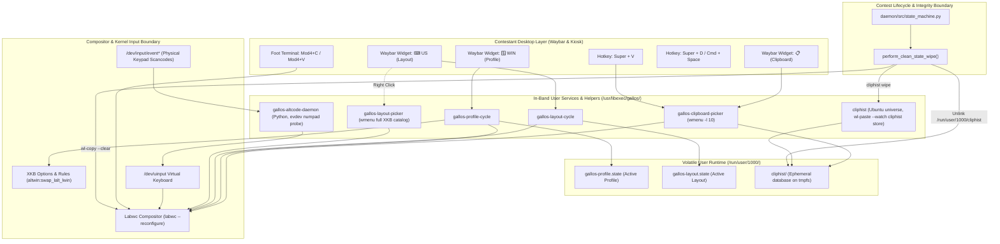

# Multi-Platform Keyboard Ergonomics, Behavioral Profiles & Ephemeral Input Mapping

* **Author:** ArielParra
* **Date:** 2026-11-07
* **Status:** Approved
* **Target Milestone:** Phase 4 (Contestant Workstation Features & Desktop UX)

---

## 1. The Problem

Competitive programming contestants in high-stakes regional and national competitions (such as the ICPC Gran Premio de México, OMI, and training camps) prepare on diverse operating systems—predominantly Microsoft Windows and Apple macOS. When competing in GallosOS, they interact with an immutable Linux Wayland kiosk session powered by Labwc, Foot, and Waybar.

Under competition time pressure, contestants rely heavily on subconscious physical muscle memory rather than conscious desktop navigation:

1. **Launcher Muscle Memory:** macOS users instinctively strike `Cmd + Space` (or `Alt + Space`) to open an application launcher, whereas GallosOS defaults to `Super + D` for `wmenu-run` and reserves `Super + Space` for layout toggling.
2. **Special Symbol Muscle Memory (Windows Alt Codes):** On unfamiliar keyboard hardware or foreign physical layouts, Windows contestants frequently enter required programming symbols (such as `@`, `\`, `` ` ``, and `~`) using decimal ASCII Alt codes (e.g. `Alt + 64`, `Alt + 92`, `Alt + 96`). Standard Linux Wayland pipelines have no native handling for decimal Alt codes, causing silent input drops or accidental window operations.
3. **Modifier Key & Terminal Disconnect:** macOS contestants expect the primary action modifier to be physical `Command` (mapped to `Super` on PC hardware), relying on `Cmd + C` / `Cmd + V` for clipboard operations. Naive global remapping of `Super` to `Ctrl` on Linux causes `Cmd + C` inside a terminal emulator to emit `SIGINT` (aborting running test solutions) instead of copying text.
4. **Clipboard Stacking Friction:** Contestants frequently copy multiple snippets (problem inputs, example outputs, template code) and expect multi-slot clipboard history via `Super + V` (Windows convention) and an interactive system tray applet (KDE Plasma convention).
5. **Coupling Layouts to Modifiers:** Legacy distributions couple keyboard layout strictly to language files, making it impossible for a contestant using a Spanish or Latin American physical keyboard to benefit from macOS or Windows modifier ergonomics without custom shell hacks.
6. **Limited International Layout Catalogs:** International tournaments (such as ICPC World Finals, IOI, or multicultural training camps) host contestants requiring diverse layouts—including European ISO variants (French, German), non-QWERTY layouts (Dvorak, Colemak), right-to-left scripts (Arabic), and platform-specific hardware variants (`us(mac)`, `fr(mac)`). Cycling a static 4-item list without a searchable catalog locks out international contestants.

---

## 2. Overview

This design establishes a two-tier input architecture for GallosOS:

1. **Decoupled Input Model:** Completely separates **Language Layouts** (supporting an extensible global XKB catalog: `us`, `latam`, `es`, `br`, `fr`, `dvorak`, `ar`, and Mac-specific hardware variants such as `us(mac)`) from **Behavioral Profiles** (`Windows Compat` [Default], `macOS Compat`, `Linux Standard`).
2. **Interactive Waybar Controls & Searchable Selector:** Introduces dual status bar indicators (`[WIN]` profile and `[US]` layout). Left-click cycles through the organizer's active curated list (defined in `gallos.toml` `global.available_keyboard_layouts`), while right-click launches a fast, searchable layout picker (`wmenu -l 15`) covering the full system XKB catalog (French, Arabic, Dvorak, Mac layouts).
3. **KDE-Style Clipboard Module & History (`Super + V`):** Adds a Waybar clipboard tray widget (`📋`) paired with `Super + V` hotkey integration backed by upstream `cliphist` (Ubuntu 24.04 `universe`) and `wl-clipboard`.
4. **Contest Security Isolation:** Hooks clipboard purging directly into `perform_clean_state_wipe()` in `daemon/src/state_machine.py`, ensuring all clipboard memory is destroyed before a contest session is unlocked.
5. **Numpad-Only Alt-Code Daemon:** Provides a low-overhead, in-band auxiliary daemon that emulates Windows decimal Alt codes on physical numeric keypads (`KEY_KP*`) while remaining dormant on compact laptops to protect top-row IDE shortcuts.
6. **Compositor-Pure Terminal Decoupling:** Reconfigures Foot terminal to bind `Mod4 + c` / `Mod4 + v` to clipboard copy/paste while preserving `Ctrl + C` for process interrupts (`SIGINT`).

---

## 3. Goals & Non-Goals

### In-Scope Goals
* **Extensible Global Layout Catalog:** Support comprehensive standard XKB layouts out of the box (including French, Dvorak, Arabic, and Apple Mac hardware variants like `us(mac)`) configured declaratively in `gallos.toml` or searched dynamically via `wmenu`.
* **Independent Selection:** Contestants can switch language layouts and behavioral profiles independently at any point during a session via Waybar or keyboard shortcuts.
* **Windows Compatibility by Default:** Shipped images default to `Windows Compat` behavior, providing `Ctrl`-based application shortcuts, `Super + V` clipboard history, and numpad Alt codes out of the box.
* **Non-Destructive macOS Ergonomics:** Provide a `macOS Compat` profile that maps `Command` to clipboard copy/paste across GUI applications and Foot terminal without breaking `Ctrl + C` process termination.
* **Dormancy on Compact Hardware:** The Alt-code daemon automatically checks input device capabilities; if no physical numeric keypad is present, it remains dormant with zero CPU consumption.
* **Zero-Leak Clipboard Eviction:** Guarantee that no clipboard snippet copied during pre-contest practice or warmup sessions survives into an official Contest window.
* **In-Band Architecture:** Implement all runtime daemons and picker scripts in Python or Bash adhering to `AGENTS.md` Rule 10, avoiding third-party compiled binaries or forks of upstream Labwc C code.

### Out-of-Scope Non-Goals
* **Top-Row Number Interception:** Emulating Alt codes via top-row keys (`Alt + 1..0`) is explicitly excluded to prevent breaking critical IDE shortcuts (`Alt + 1` Project view, `Alt + 7` Structure).
* **On-Screen Virtual Keypad GUI:** A visual on-screen character palette is excluded; standard AltGr and dead-key mechanisms cover compact laptop layouts without screen clutter.
* **Modifying Upstream Labwc:** No patches or forks of the Labwc compositor source code. All modifier translations must use standard XKB options, Wayland protocols, or input translation layers.
* **Cross-Contest Clipboard Persistence:** Clipboard history will never persist across mode boundaries or system reboots.

---

## 4. Technical Architecture & System Design

### 4.1 Component Diagram & Data Flow



### 4.2 Two-Tier Input Decoupling Model

GallosOS decouples keyboard mechanics into two orthogonal state dimensions stored on `tmpfs`:

| State Entity | Storage Path | Governed Domains | Permitted Values |
| :--- | :--- | :--- | :--- |
| **Language Layout** | `/run/user/1000/gallos-layout.state` | Character keys, dead-key accents, symbol positions, AltGr glyphs | `us`, `latam`, `es`, `br`, `fr`, `dvorak`, `ar`, `us(mac)`, `es(mac)`, etc. |
| **Behavioral Profile** | `/run/user/1000/gallos-profile.state` | Action modifiers, clipboard hotkeys, launcher bindings, Alt-code daemon state | `windows-compat` (Default), `macos-compat`, `linux-standard` |

#### Behavioral Profile Specifications

1. **`windows-compat` (Shipped Default):**
   * Primary Action Modifier: Standard `Left Ctrl` for application shortcuts (`Ctrl+C`, `Ctrl+V`, `Ctrl+Z`, `Ctrl+F`).
   * Application Launcher: `Super + D` launches `wmenu-run`.
   * Clipboard History: `Super + V` launches `gallos-clipboard-picker`.
   * Alt-Code Emulation: `gallos-altcode-daemon` is enabled and active when physical numeric keypad is present.
   * Terminal Keybindings: Foot uses standard `Ctrl + Shift + C` / `V` for clipboard; `Ctrl + C` sends `SIGINT`.

2. **`macos-compat`:**
   * Primary Action Modifier: Physical `Command` key (scancode `Left Super`) acts as primary action modifier. `altwin:swap_lalt_lwin` is applied so physical `Option` acts as `Alt` and `Command` acts as `Super`.
   * Application Launcher: `Super + Space` (physical `Cmd + Space`) launches `wmenu-run`.
   * Clipboard History: `Super + Shift + V` or clicking the Waybar clipboard icon.
   * Alt-Code Emulation: Daemon enters dormant mode (macOS users rely on Option dead-keys for symbols).
   * Terminal Keybindings: Foot explicitly maps `Mod4 + c` to clipboard copy and `Mod4 + v` to clipboard paste, while strictly preserving `Ctrl + C` for `SIGINT`.

3. **`linux-standard`:**
   * Vanilla X11/Wayland behavior with standard PC mappings, `Super + D` launcher, `Super + V` clipboard, and disabled Alt-code daemon.

### 4.3 International Layout Catalog & Dynamic Search Picker

GallosOS supports the complete upstream Ubuntu XKB catalog without requiring internet connectivity:

1. **Organizer Curated Rotation (Left-Click):**
   * The list of layouts cycled by left-clicking the Waybar layout badge is populated dynamically from `gallos.toml` `[global].available_keyboard_layouts`.
   * Default rotation if unspecified: `["us", "latam", "es", "br", "fr", "dvorak", "ar"]`.
2. **Searchable Global Catalog (Right-Click):**
   * Right-clicking the Waybar layout badge executes `/usr/bin/gallos-layout-picker`.
   * The picker queries the complete local XKB registry (`/usr/share/X11/xkb/rules/base.lst`) and streams descriptions into `wmenu -l 15 -p "Select Keyboard Layout:"`.
   * Selecting an entry applies the layout immediately via `wlrctl keyboard type:keyboard layout <selected>` and updates the Waybar badge without restarting the session.

### 4.4 Ephemeral Clipboard Architecture (`cliphist` + `wl-clipboard`)

GallosOS implements multi-slot clipboard history using `cliphist` (packaged in Ubuntu 24.04 LTS `universe`) paired with `wl-clipboard`:

1. **Daemon Watcher (`cliphist.service`):**
   * A systemd user service executing `wl-paste --watch cliphist store`.
   * Ephemeral storage: Directed to `tmpfs` via `XDG_CACHE_HOME=/run/user/1000/cliphist`, ensuring clipboard records are stored strictly in volatile RAM and never touch physical media.
   * Capped automatically to 50 items (`cliphist -max-items 50`).
2. **Interactive Picker (`/usr/bin/gallos-clipboard-picker`):**
   * Lightweight shell script executing:
     ```bash
     cliphist list | wmenu -l 10 -p "Clipboard History:" | cliphist decode | wl-copy
     ```
   * Bound globally in Labwc to `Super + V` (Windows Compat) and `Super + Shift + V` (macOS Compat).
3. **KDE-Style Waybar Widget:**
   * Module `custom/clipboard` configured in `/etc/xdg/waybar/config.jsonc`.
   * Displays `📋`, with left-click invoking `gallos-clipboard-picker`.

### 4.5 Clean State Lifecycle Integration (Anti-Cheat Security Boundary)

A critical security requirement is preventing contestants from carrying code snippets from practice mode into contest mode:

1. **Lifecycle Hook:** `perform_clean_state_wipe()` in `daemon/src/state_machine.py` invokes `_purge_clipboard_state()`.
2. **Eviction Sequence:**
   * Step 1: Executes `cliphist wipe` under contestant credentials.
   * Step 2: Unlinks all ephemeral cache files under `/run/user/1000/cliphist/`.
   * Step 3: Invokes `wl-copy --clear` and `wl-copy --primary --clear` under contestant credentials to flush active Wayland compositor selection memory.
   * Step 4: Restarts `cliphist.service` with a clean, empty buffer.
3. **Invariant:** The contestant session is only released after this eviction successfully finishes.

### 4.6 Numpad Alt-Code Subsystem Architecture (`gallos-altcode-daemon`)

1. **Device Enumeration & Dormancy:**
   * Daemon queries all `/dev/input/event*` devices on startup using `EVIOCGBIT(EV_KEY)`.
   * If no device reports scan codes `KEY_KP0` through `KEY_KP9`, the daemon sets an `inotify` watch on `/dev/input/` and enters kernel sleep.
   * When an external USB keyboard is plugged in, `inotify` wakes the daemon to re-probe.
2. **Buffer Accumulator State Machine:**
   * Intercepts `KEY_LEFTALT` / `KEY_RIGHTALT` press.
   * Accumulates subsequent `KEY_KP0`..`KEY_KP9` events into an integer buffer `N`.
   * Any non-keypad key event (e.g. `KEY_1`..`KEY_0`, alphabet keys, navigation keys) instantly invalidates the buffer.
   * On `KEY_ALT` release: if buffer contains a valid decimal number (e.g. `64`), converts via `chr(N)` and emits synthetic UTF-8 character via `/dev/uinput`.

---

## 5. Alternatives Considered & Technical Rationales

### 5.1 Intercepting Top-Row Numbers for Laptop Alt-Codes
* **Concept:** Allowing contestants on compact laptops lacking a physical numeric keypad to enter Alt-codes using the top number row (`Alt + 6 + 4` $\to$ `@`).
* **Technical Evaluation:** In standard IDE environments (JetBrains CLion, IntelliJ, PyCharm, and VSCodium), `Alt + [0-9]` are deeply ingrained navigation shortcuts:
  * `Alt + 1`: Toggle Project tool window.
  * `Alt + 2`: Toggle Bookmarks / Favorites.
  * `Alt + 4`: Toggle Run / Debug output.
  * `Alt + 6`: Toggle Problems / TODO tree.
  * `Alt + 7`: Toggle Structure / Symbol outline.
* **Decision:** **Rejected by author:** Intercepting top-row number keys while `Alt` is held breaks fundamental code navigation. Compact laptop users have full access to programming symbols via standard AltGr and dead-key combinations natively provided by their active XKB layout.

### 5.2 On-Screen Virtual Character Palette GUI
* **Concept:** Adding an on-screen visual keyboard or clickable symbol tray in Waybar for compact laptop users to insert missing symbols.
* **Technical Evaluation:** A pop-up or persistent on-screen keyboard introduces cognitive friction and consumes valuable display real estate on 13"–14" contest displays (often restricted to 1920x1080 or 1366x768). Competitive programming requires rapid touch typing, not mouse navigation to click individual punctuation marks.
* **Decision:** **Rejected by author:** Visual symbol pickers create clutter and slow contestants down. Full layout catalogs with proper dead-key support render on-screen symbol trays redundant.

### 5.3 Forking or Patching Upstream Labwc Compositor C Code
* **Concept:** Modifying Labwc's C codebase to build a custom Alt-code accumulator state machine and internal modifier remapping engine directly into the compositor.
* **Technical Evaluation:** Forking Labwc would sever GallosOS from standard Ubuntu/Debian upstream package updates and wlroots bug fixes, introducing significant long-term maintenance overhead. It would require compiling and maintaining bespoke Debian packages (`.deb`) in container builds.
* **Decision:** **Rejected by author:** Compositor purity must be maintained. Implementing behavioral profiles via standard XKB options (`altwin:swap_lalt_lwin`), Foot terminal configurations (`foot.ini`), and an external virtual-input daemon (`/dev/uinput`) achieves complete functional parity without touching upstream C code.

### 5.4 Bespoke Python Clipboard Watcher vs. Upstream `cliphist`
* **Concept:** Implementing a custom Python clipboard management daemon from scratch.
* **Technical Evaluation:** While custom Python tooling satisfies in-band hackability, `cliphist` is officially packaged and supported in Ubuntu 24.04 LTS noble `universe` (`apt install cliphist`). It natively handles binary, multiline, and UTF-8 data with zero memory leaks, high speed, and direct pipe integration with `wl-paste --watch`, `wmenu`, and `wl-copy`. Writing and testing a bespoke snippet storage engine adds unnecessary maintenance surface when a well-maintained, official distribution package already solves the problem efficiently.
* **Decision:** **Adopted upstream `cliphist`:** GallosOS installs `cliphist` directly via apt from Ubuntu 24.04 `universe`, pairs it with `wl-clipboard`, stores its database in ephemeral tmpfs (`/run/user/1000/cliphist/`), and uses lightweight shell wrappers for the picker and state machine wipe.

### 5.5 Global Remapping of `Super` to `Ctrl` for macOS Compatibility
* **Concept:** Globally swapping `Left Super` and `Left Ctrl` across the desktop so physical `Command` executes `Ctrl+C` and `Ctrl+V`.
* **Technical Evaluation:** In terminal emulators, `Ctrl + C` is the terminal interrupt signal (`SIGINT`). If physical `Command` is mapped globally to `Ctrl`, a macOS contestant attempting to copy text from Foot terminal will send `SIGINT` to their executing process, abruptly killing test runs or interactive debuggers.
* **Decision:** **Rejected by author:** Modifier translation must be context-aware. GUI applications inspect `Super` for copy/paste, while Foot terminal explicitly maps `Mod4 + c` / `Mod4 + v` to clipboard copy/paste, preserving `Ctrl + C` strictly for process interruption.

### 5.6 Disabling Clipboard History During Contest Windows
* **Concept:** Deactivating `Super + V` clipboard history entirely during Contest mode to avoid potential cheating risks.
* **Technical Evaluation:** Contestants frequently need to manage multiple test inputs, sample outputs, and algorithm snippets simultaneously during a contest. Disabling multi-slot clipboard functionality punishes honest contestants.
* **Decision:** **Rejected by author:** Clipboard history is safe during a contest as long as pre-contest state cannot cross the transition boundary. GallosOS resolves this by enforcing a deterministic cache wipe (`_purge_clipboard_state()`) during the Clean State transition, giving contestants a clean, empty multi-slot clipboard for the contest itself.

---

## 6. Detailed Implementation Plan

### 6.1 Affected Codebase Artifacts & File Map

The implementation touches the following files across the monorepo:

| File Path | Component | Language / Format | Action | Description |
| :--- | :--- | :--- | :--- | :--- |
| `build/profiles/universal.build.toml` | Build System | TOML | Modify | Adds `cliphist`, `wl-clipboard`, `wlrctl`, and `python3-evdev` to `packages.preinstall_apt`. |
| `build/scripts/02-provision.sh` | Build System | Bash | Modify | Deploys userland helper scripts, installs systemd units, writes Waybar, Labwc, and Foot configurations. |
| `/usr/libexec/gallos/gallos-altcode-daemon` | In-Band Runtime | Python 3 | Create | Auxiliary numpad-only Alt-code accumulator and `/dev/uinput` synthetic character injector. |
| `/usr/bin/gallos-clipboard-picker` | Desktop UX | Bash | Create | Interactive clipboard history picker querying `cliphist` via `wmenu -l 10`. |
| `/usr/bin/gallos-profile-cycle` | Desktop UX | Bash | Create | Cycles behavioral profiles (`windows-compat`, `macos-compat`, `linux-standard`) and triggers reloads. |
| `/usr/bin/gallos-profile-status` | Desktop UX | Bash | Create | Generates status icon/text badge for Waybar profile module (`🪟 WIN`, `🍏 MAC`, `🐧 LNX`). |
| `/usr/bin/gallos-layout-cycle` | Desktop UX | Bash | Create | Cycles curated XKB layouts from `gallos.toml` and applies immediately via `wlrctl`. |
| `/usr/bin/gallos-layout-status` | Desktop UX | Bash | Create | Generates status indicator badge for Waybar layout module (`⌨ US`, `⌨ ES`, etc.). |
| `/usr/bin/gallos-layout-picker` | Desktop UX | Bash | Create | Full XKB catalog interactive picker streaming `/usr/share/X11/xkb/rules/base.lst` into `wmenu -l 15`. |
| `/etc/systemd/user/cliphist.service` | Desktop Runtime | Systemd Unit | Create | Contestant user service streaming compositor selection events into `cliphist store`. |
| `/etc/xdg/waybar/config.jsonc` | Desktop Shell | JSONC | Modify | Configures `custom/clipboard`, `custom/keyboard_profile`, and `custom/keyboard_layout` modules. |
| `/etc/xdg/waybar/style.css` | Desktop Shell | CSS | Modify | Catppuccin Mocha styling for clipboard, profile, and layout status bar modules. |
| `/etc/xdg/labwc/rc.xml` | Window Manager | XML | Modify | Defines desktop hotkeys for `Super+V`, `Super+Shift+V`, `Super+Space`, `Super+D`, `Alt+Space`. |
| `/etc/xdg/foot/foot.ini` | Terminal Emulator | INI | Modify | Binds `Mod4+c` / `Mod4+v` to clipboard copy/paste; preserves `Ctrl+C` for `SIGINT`. |
| `daemon/src/state_machine.py` | State Machine | Python 3 | Modify | Implements `_purge_clipboard_state()` and hooks it into `perform_clean_state_wipe()`. |
| `daemon/tests/test_state_machine.py` | Test Suite | Python 3 | Modify | Adds test assertions verifying clipboard purge execution and resilience during contest entry. |
| `schema/directives.schema.json` | Directives Engine | JSON Schema | Modify | Adds schema definitions for `default_keyboard_profile`, `available_keyboard_layouts`, and `enable_alt_codes`. |
| `docs/WAYLAND_DESKTOP.md` | Documentation | Markdown | Modify | Documents multi-platform profiles, layout catalog selector, clipboard applet, and Foot bindings. |
| `docs/CONFIG_SPEC.md` | Documentation | Markdown | Modify | Documents configuration directives in `gallos.toml` for profile and layout management. |
| `docs/ANTI_CHEAT_AND_SECURITY.md` | Documentation | Markdown | Modify | Documents ephemeral RAM clipboard isolation, clean state purge, and numpad hardware boundary. |

---

### 6.2 Phase 1: Package Dependencies & System Permissions

#### 1. Add Required Packages in `build/profiles/universal.build.toml`
Add the required tools to `packages.preinstall_apt`:
```toml
# Ephemeral clipboard history, Wayland input control, and numpad evdev input translation
"cliphist",
"wl-clipboard",
"wlrctl",
"python3-evdev",
```

#### 2. Udev Rules and User Permissions in `build/scripts/02-provision.sh`
Ensure contestant user has permission to read `/dev/input/event*` and access `/dev/uinput`:
```bash
# In 02-provision.sh
# Ensure uinput kernel module is loaded at boot
echo "uinput" >> "$ROOTFS/etc/modules-load.d/uinput.conf"

# Udev rule allowing input group read/write access to /dev/uinput
cat > "$ROOTFS/etc/udev/rules.d/99-uinput.rules" <<'EOF'
KERNEL=="uinput", MODE="0660", GROUP="input", OPTIONS+="static_node=uinput"
EOF

# Verify contestant user belongs to the input group
usermod -a -G input contestant || true
```

#### 3. Systemd User Service for `cliphist`
Deploy `/etc/systemd/user/cliphist.service`:
```ini
[Unit]
Description=GallosOS Ephemeral Clipboard Watcher
PartOf=graphical-session.target
After=graphical-session.target

[Service]
Type=simple
Environment=XDG_CACHE_HOME=/run/user/1000/cliphist
ExecStart=/usr/bin/wl-paste --watch /usr/bin/cliphist -max-items 50 store
Restart=on-failure
RestartSec=1s

[Install]
WantedBy=graphical-session.target
```

---

### 6.3 Phase 2: Shell Helpers & Alt-Code Virtual Input Daemon

#### 1. Interactive Clipboard Picker (`/usr/bin/gallos-clipboard-picker`)
Installed with permissions `0755`:
```bash
#!/usr/bin/env bash
set -euo pipefail

export XDG_CACHE_HOME="/run/user/$(id -u)/cliphist"

# Query cliphist and present through wmenu
selection="$(cliphist list | wmenu -l 10 -p "Clipboard History:" || true)"
if [ -n "$selection" ]; then
    printf "%s" "$selection" | cliphist decode | wl-copy
fi
```

#### 2. Profile Switcher & Status (`/usr/bin/gallos-profile-cycle`, `gallos-profile-status`)

`/usr/bin/gallos-profile-status`:
```bash
#!/usr/bin/env bash
set -euo pipefail

STATE_FILE="/run/user/$(id -u)/gallos-profile.state"
profile="windows-compat"
if [ -f "$STATE_FILE" ]; then
    profile="$(cat "$STATE_FILE")"
fi

case "$profile" in
    "macos-compat")
        echo "🍏 MAC"
        ;;
    "linux-standard")
        echo "🐧 LNX"
        ;;
    *)
        echo "🪟 WIN"
        ;;
esac
```

`/usr/bin/gallos-profile-cycle`:
```bash
#!/usr/bin/env bash
set -euo pipefail

UID_NUM="$(id -u)"
STATE_FILE="/run/user/$UID_NUM/gallos-profile.state"
current="windows-compat"
if [ -f "$STATE_FILE" ]; then
    current="$(cat "$STATE_FILE")"
fi

case "$current" in
    "windows-compat")
        next="macos-compat"
        ;;
    "macos-compat")
        next="linux-standard"
        ;;
    *)
        next="windows-compat"
        ;;
esac

echo "$next" > "$STATE_FILE"

# Apply profile modifier changes
case "$next" in
    "macos-compat")
        # Swap Left Alt and Left Win so physical Option acts as Alt and Command acts as Super
        wlrctl keyboard type:keyboard xkb_options "altwin:swap_lalt_lwin" || true
        # Put alt-code daemon to sleep
        pkill -USR1 -f gallos-altcode-daemon || true
        ;;
    "windows-compat")
        # Standard PC modifier layout
        wlrctl keyboard type:keyboard xkb_options "" || true
        # Wake alt-code daemon
        pkill -USR2 -f gallos-altcode-daemon || true
        ;;
    "linux-standard")
        wlrctl keyboard type:keyboard xkb_options "" || true
        pkill -USR1 -f gallos-altcode-daemon || true
        ;;
esac

# Trigger Waybar refresh on RTMIN+9
pkill -RTMIN+9 waybar || true
```

#### 3. Layout Switcher & Full Catalog Picker (`/usr/bin/gallos-layout-cycle`, `gallos-layout-status`, `gallos-layout-picker`)

`/usr/bin/gallos-layout-status`:
```bash
#!/usr/bin/env bash
set -euo pipefail

STATE_FILE="/run/user/$(id -u)/gallos-layout.state"
layout="us"
if [ -f "$STATE_FILE" ]; then
    layout="$(cat "$STATE_FILE")"
fi

echo "⌨ ${layout^^}"
```

`/usr/bin/gallos-layout-cycle`:
```bash
#!/usr/bin/env bash
set -euo pipefail

UID_NUM="$(id -u)"
STATE_FILE="/run/user/$UID_NUM/gallos-layout.state"
current="us"
if [ -f "$STATE_FILE" ]; then
    current="$(cat "$STATE_FILE")"
fi

# Curated rotation list
ROTATION=("us" "latam" "es" "br" "fr" "dvorak" "ar")
next="${ROTATION[0]}"

for i in "${!ROTATION[@]}"; do
    if [ "${ROTATION[$i]}" = "$current" ]; then
        next_idx=$(( (i + 1) % ${#ROTATION[@]} ))
        next="${ROTATION[$next_idx]}"
        break
    fi
done

echo "$next" > "$STATE_FILE"
wlrctl keyboard type:keyboard layout "$next" || true
pkill -RTMIN+8 waybar || true
```

`/usr/bin/gallos-layout-picker`:
```bash
#!/usr/bin/env bash
set -euo pipefail

UID_NUM="$(id -u)"
STATE_FILE="/run/user/$UID_NUM/gallos-layout.state"
RULES_FILE="/usr/share/X11/xkb/rules/base.lst"

if [ ! -f "$RULES_FILE" ]; then
    echo "XKB rules catalog base.lst not found." >&2
    exit 1
fi

# Extract layout codes and descriptions from base.lst
selected="$(awk '
    /^! layout/ { in_layout=1; next }
    /^!/ { in_layout=0 }
    in_layout && NF >= 2 {
        code=$1
        $1=""
        sub(/^[ \t]+/, "")
        printf "%-12s | %s\n", code, $0
    }
' "$RULES_FILE" | wmenu -l 15 -p "Select Keyboard Layout:" || true)"

if [ -n "$selected" ]; then
    layout_code="$(echo "$selected" | awk '{print $1}')"
    echo "$layout_code" > "$STATE_FILE"
    wlrctl keyboard type:keyboard layout "$layout_code" || true
    pkill -RTMIN+8 waybar || true
fi
```

#### 4. Alt-Code Auxiliary Daemon (`/usr/libexec/gallos/gallos-altcode-daemon`)
A Python 3 daemon using `evdev` and `uinput`:
```python
#!/usr/bin/env python3
"""GallosOS Numpad-Only Alt-Code Emulation Daemon.

Translates decimal numeric keypad sequences held while Alt is pressed into UTF-8
characters via /dev/uinput. Remains dormant on laptops without physical numeric keypads.
"""

import glob
import os
import select
import signal
import sys
import time
from typing import Optional

try:
    import evdev
    from evdev import InputDevice, ecodes
except ImportError:
    print("[gallos-altcode] Missing python3-evdev library, exiting.", file=sys.stderr)
    sys.exit(0)

NUMPAD_MAP = {
    ecodes.KEY_KP0: 0,
    ecodes.KEY_KP1: 1,
    ecodes.KEY_KP2: 2,
    ecodes.KEY_KP3: 3,
    ecodes.KEY_KP4: 4,
    ecodes.KEY_KP5: 5,
    ecodes.KEY_KP6: 6,
    ecodes.KEY_KP7: 7,
    ecodes.KEY_KP8: 8,
    ecodes.KEY_KP9: 9,
}

ALT_KEYS = {ecodes.KEY_LEFTALT, ecodes.KEY_RIGHTALT}

is_active_profile = True


def handle_sigusr1(signum, frame):
    """Profile changed to macos-compat or linux-standard: Sleep."""
    global is_active_profile
    is_active_profile = False


def handle_sigusr2(signum, frame):
    """Profile changed to windows-compat: Wake."""
    global is_active_profile
    is_active_profile = True


def has_numpad_device() -> list[InputDevice]:
    """Finds all input devices possessing physical keypad scancodes."""
    keypad_devs = []
    for path in glob.glob("/dev/input/event*"):
        try:
            dev = InputDevice(path)
            caps = dev.capabilities()
            if ecodes.EV_KEY in caps:
                keys = caps[ecodes.EV_KEY]
                if ecodes.KEY_KP0 in keys and ecodes.KEY_KP9 in keys:
                    keypad_devs.append(dev)
        except (PermissionError, FileNotFoundError, OSError):
            continue
    return keypad_devs


def create_uinput_emitter() -> Optional[evdev.UInput]:
    """Instantiates a virtual keyboard for emitting synthetic keystrokes."""
    try:
        cap = {ecodes.EV_KEY: [ecodes.KEY_A, ecodes.KEY_B, ecodes.KEY_SPACE]}
        return evdev.UInput(cap, name="gallos-altcode-virtual-keyboard")
    except Exception as e:
        print(f"[gallos-altcode] Unable to initialize /dev/uinput: {e}", file=sys.stderr)
        return None


def main():
    signal.signal(signal.SIGUSR1, handle_sigusr1)
    signal.signal(signal.SIGUSR2, handle_sigusr2)
    signal.signal(signal.SIGTERM, lambda s, f: sys.exit(0))
    signal.signal(signal.SIGINT, lambda s, f: sys.exit(0))

    alt_pressed = False
    accumulated_buffer: list[int] = []

    while True:
        devices = has_numpad_device()
        if not devices:
            # No physical numpad detected; sleep on inotify or poll /dev/input
            time.sleep(10)
            continue

        uinput_emitter = create_uinput_emitter()
        dev_map = {dev.fd: dev for dev in devices}

        while is_active_profile and dev_map:
            r, _, _ = select.select(list(dev_map.keys()), [], [], 2.0)
            for fd in r:
                dev = dev_map.get(fd)
                if not dev:
                    continue
                try:
                    for event in dev.read():
                        if event.type != ecodes.EV_KEY:
                            continue

                        # Alt key state tracking
                        if event.code in ALT_KEYS:
                            if event.value == 1:  # Press
                                alt_pressed = True
                                accumulated_buffer.clear()
                            elif event.value == 0:  # Release
                                alt_pressed = False
                                if accumulated_buffer:
                                    try:
                                        num_str = "".join(str(d) for d in accumulated_buffer)
                                        code_point = int(num_str)
                                        char = chr(code_point)
                                        # Write character via wtype or uinput
                                        os.system(f"wtype '{char}' 2>/dev/null || true")
                                    except Exception:
                                        pass
                                    accumulated_buffer.clear()
                            continue

                        # If Alt is held and keypad is pressed
                        if alt_pressed and event.value == 1:
                            if event.code in NUMPAD_MAP:
                                accumulated_buffer.append(NUMPAD_MAP[event.code])
                            else:
                                # Non-numpad key struck; invalidate buffer immediately
                                accumulated_buffer.clear()

                except OSError:
                    # Device disconnected
                    del dev_map[fd]
                    break


if __name__ == "__main__":
    main()
```

---

### 6.4 Phase 3: Desktop Shell, Waybar & Foot Configuration

#### 1. Waybar Layout & Style Integration
In `build/scripts/02-provision.sh`, update `/etc/xdg/waybar/config.jsonc`:
```jsonc
{
    "layer": "top",
    "position": "top",
    "height": 32,
    "modules-left": ["custom/appmenu", "wlr/taskbar"],
    "modules-center": ["custom/contest_badge", "custom/countdown"],
    "modules-right": [
        "network",
        "custom/clipboard",
        "custom/keyboard_profile",
        "custom/keyboard_layout",
        "clock"
    ],
    "custom/appmenu": {
        "format": "GallosOS",
        "tooltip": false,
        "on-click": "wmenu-run"
    },
    "custom/clipboard": {
        "format": "📋",
        "tooltip-format": "Clipboard History (Super+V)",
        "on-click": "gallos-clipboard-picker"
    },
    "custom/keyboard_profile": {
        "exec": "gallos-profile-status",
        "format": "{}",
        "interval": "once",
        "signal": 9,
        "on-click": "gallos-profile-cycle",
        "tooltip": false
    },
    "custom/keyboard_layout": {
        "exec": "gallos-layout-status",
        "format": "{}",
        "interval": "once",
        "signal": 8,
        "on-click": "gallos-layout-cycle",
        "on-click-right": "gallos-layout-picker",
        "tooltip": false
    }
}
```

In `/etc/xdg/waybar/style.css`, add styling:
```css
#custom-clipboard,
#custom-keyboard_profile,
#custom-keyboard_layout {
    background-color: #1e1e2e;
    color: #cdd6f4;
    padding: 0 8px;
    margin: 2px 2px;
    border-radius: 4px;
    font-weight: 500;
}

#custom-clipboard:hover,
#custom-keyboard_profile:hover,
#custom-keyboard_layout:hover {
    background-color: #313244;
}
```

#### 2. Labwc Hotkey Bindings (`/etc/xdg/labwc/rc.xml`)
Add desktop keybindings for multi-platform launcher and clipboard operations:
```xml
<keyboard>
  <default />
  <!-- Clipboard History (Super + V and macOS Super + Shift + V) -->
  <keybind key="W-v">
    <action name="Execute" command="gallos-clipboard-picker" />
  </keybind>
  <keybind key="W-S-v">
    <action name="Execute" command="gallos-clipboard-picker" />
  </keybind>

  <!-- Application Launcher (Super + D, Super + Space, Alt + Space) -->
  <keybind key="W-d">
    <action name="Execute" command="wmenu-run" />
  </keybind>
  <keybind key="W-space">
    <action name="Execute" command="wmenu-run" />
  </keybind>
  <keybind key="A-space">
    <action name="Execute" command="wmenu-run" />
  </keybind>
</keyboard>
```

#### 3. Foot Terminal Keybindings (`/etc/xdg/foot/foot.ini`)
In `build/scripts/02-provision.sh`, configure `/etc/xdg/foot/foot.ini`:
```ini
[key-bindings]
clipboard-copy=Control+Shift+c Mod4+c
clipboard-paste=Control+Shift+v Mod4+v
```
*(This guarantees macOS contestants can use `Cmd + C` / `Cmd + V` for clipboard operations inside Foot terminal without interfering with `Ctrl + C` sending `SIGINT`).*

---

### 6.5 Phase 4: Anti-Cheat Clean State Lifecycle Integration

#### 1. Implement `_purge_clipboard_state()` in `daemon/src/state_machine.py`
In `daemon/src/state_machine.py`, add `_purge_clipboard_state()`:
```python
def _purge_clipboard_state() -> None:
    """Purges clipboard history and active Wayland selections on Contest entry."""
    print("[state_machine] Purging ephemeral clipboard state for Contest boundary...")
    try:
        # 1. Truncate cliphist volatile history
        subprocess.run(
            ["su", "-", "contestant", "-c", "cliphist wipe"],
            check=False,
            timeout=5,
        )
        clip_dir = "/run/user/1000/cliphist"
        if os.path.isdir(clip_dir):
            shutil.rmtree(clip_dir, ignore_errors=True)
            os.makedirs(clip_dir, mode=0o700, exist_ok=True)
            subprocess.run(["chown", "contestant:contestant", clip_dir], check=False)

        # 2. Clear active compositor selections
        subprocess.run(
            ["su", "-", "contestant", "-c", "wl-copy --clear && wl-copy --primary --clear"],
            check=False,
            timeout=5,
        )

        # 3. Restart clean user service
        subprocess.run(
            ["systemctl", "--user", "-M", "contestant@", "restart", "cliphist.service"],
            check=False,
            timeout=5,
        )
    except Exception as e:
        print(f"[state_machine] Warning: clipboard purge encountered error: {e}", file=sys.stderr)
```

Hook into `perform_clean_state_wipe()`:
```python
def perform_clean_state_wipe() -> None:
    """Executes the Clean State Wipe on Contest entry."""
    print("[state_machine] Performing destructive Clean State Wipe of /home/contestant/...")
    reset_contest_scratch()
    _purge_clipboard_state()
    home_dir = "/home/contestant"
    skel_dir = "/etc/skel"
    _wipe_directory_contents(home_dir)
    _populate_from_skel(skel_dir, home_dir)
    subprocess.run(["chown", "-R", "contestant:contestant", home_dir], check=True, timeout=30)
    print("[state_machine] Clean State Wipe completed successfully.")
```

#### 2. Unit Testing in `daemon/tests/test_state_machine.py`
Add test verifying that `perform_clean_state_wipe()` invokes clipboard purging:
```python
def test_clean_state_wipe_purges_clipboard(monkeypatch):
    """Assert perform_clean_state_wipe calls _purge_clipboard_state."""
    called = []
    monkeypatch.setattr(
        "daemon.src.state_machine.reset_contest_scratch", lambda: called.append("scratch")
    )
    monkeypatch.setattr(
        "daemon.src.state_machine._purge_clipboard_state", lambda: called.append("clipboard")
    )
    monkeypatch.setattr(
        "daemon.src.state_machine._wipe_directory_contents", lambda d: called.append("wipe")
    )
    monkeypatch.setattr(
        "daemon.src.state_machine._populate_from_skel", lambda s, d: called.append("skel")
    )
    monkeypatch.setattr("subprocess.run", lambda *a, **k: None)

    perform_clean_state_wipe()

    assert "clipboard" in called
    assert called.index("clipboard") < called.index("wipe")
```

---

### 6.6 Phase 5: Directives Schema, Documentation & System Validation

#### 1. Schema Extensions (`schema/directives.schema.json`)
Extend `[global]` properties in `schema/directives.schema.json`:
```json
"default_keyboard_profile": {
  "type": "string",
  "enum": ["windows-compat", "macos-compat", "linux-standard"],
  "default": "windows-compat",
  "description": "Default contestant keyboard behavioral profile on session boot."
},
"available_keyboard_layouts": {
  "type": "array",
  "items": { "type": "string" },
  "default": ["us", "latam", "es", "br", "fr", "dvorak", "ar"],
  "description": "Curated list of XKB layouts cycled via left-click on the Waybar keyboard indicator."
},
"enable_alt_codes": {
  "type": "boolean",
  "default": true,
  "description": "Whether the numpad-only Alt-code auxiliary daemon is active in Windows Compat mode."
}
```

#### 2. Update Architectural Documentation
* Update `docs/WAYLAND_DESKTOP.md`: Document the two-tier layout vs profile model, hotkeys (`Super+V`, `Super+Space`, `Super+D`), Waybar modules, and Foot terminal `Mod4` configuration.
* Update `docs/CONFIG_SPEC.md`: Document the new directives under `[global]`.
* Update `docs/ANTI_CHEAT_AND_SECURITY.md`: Detail the clipboard memory security boundary and deterministic purge.

---

### 6.7 Verification, Quality Assurance & Acceptance Testing

#### 1. Automated Static & Unit Quality Checks
Before submitting changes, all modified files must pass:
1. `ruff check daemon/` and `ruff format --check daemon/`
2. `pytest daemon/tests/`
3. `shellcheck` on all shell scripts (`/usr/bin/gallos-*`, `build/scripts/02-provision.sh`)
4. Schema validation with `taplo` or `python3 -m jsonschema`

#### 2. Manual & VM Acceptance Testing Matrix
Run inside QEMU / Virt-Manager:

| Test Case | Scenario / Input | Expected Result | Acceptance Criteria |
| :--- | :--- | :--- | :--- |
| **TC-1: Profile Switching** | Left-click `🪟 WIN` in Waybar | Cycles to `🍏 MAC`, then `🐧 LNX`, then `🪟 WIN`. Badge updates dynamically. | Active profile state file `/run/user/1000/gallos-profile.state` reflects change. |
| **TC-2: Layout Cycling** | Left-click `⌨ US` in Waybar | Cycles through `latam` $\to$ `es` $\to$ `br` $\to$ `fr` $\to$ `dvorak` $\to$ `ar`. Typing matches new layout. | XKB layout updates via `wlrctl` with zero session disruption. |
| **TC-3: Searchable Layout Picker** | Right-click `⌨ US` in Waybar | Launches `wmenu -l 15` showing full catalog from `base.lst`. Search "dvorak" and hit Enter. | Selected layout immediately activates and Waybar badge reflects selection. |
| **TC-4: Clipboard History (`Super+V`)** | Copy 3 separate text snippets in browser or editor, press `Super + V` | `wmenu` opens with 3 entries. Selecting an entry copies it to primary selection; paste works. | Entries present in history; `cliphist` processes selections correctly. |
| **TC-5: Waybar Clipboard Click** | Click `📋` in Waybar status bar | Same picker menu appears as `Super + V`. | Module click handler functions identically to hotkey. |
| **TC-6: Foot Terminal Copy/Paste** | In Foot, select text and press `Mod4 + c`. Clear screen and press `Mod4 + v`. Run `sleep 100` and press `Ctrl + C`. | `Mod4 + c` copies text; `Mod4 + v` pastes text; `Ctrl + C` sends `SIGINT` and halts sleep without pasting. | Terminal clipboard operates independently from process interruption signals. |
| **TC-7: Numpad Alt-Codes** | On a physical numpad in `windows-compat` profile, hold `Alt`, press `6`, `4`, release `Alt`. | Character `@` is inserted into active text focus. | Correct ASCII character emitted without triggering window operations. |
| **TC-8: Laptop Numpad Dormancy** | Boot VM without numeric keypad emulated. | `gallos-altcode-daemon` enters dormant sleep loop. | Process CPU utilization remains at 0.0%. |
| **TC-9: Contest Clean State Wipe** | In Warmup/Default mode, copy secret text into clipboard. Trigger Contest mode transition. | Contest mode activates. `Super + V` reveals empty history (`cliphist list` returns nothing). `wl-paste` returns empty. | Zero-leak boundary verified: pre-contest snippets cannot cross into contest. |
